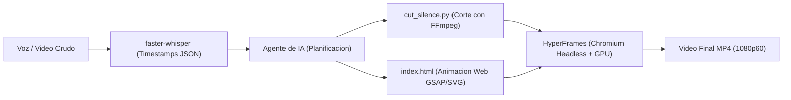

# Video Pipeline

Entorno local automatizado de produccion y edicion de video programatico gobernado por agentes de inteligencia artificial y codigo declarativo.

El sistema resuelve el problema del costo y la friccion de la edicion audiovisual manual mediante una tuberia local que sincroniza modelos de transcripcion temporalizada con motores de composicion web (HTML5, SVG y GSAP) y aceleracion grafica por hardware, operando bajo una politica estricta de **cero costes adicionales**.



---

## 1. Requisitos Previos y Compatibilidad de Entorno

* **Sistema Operativo:** Distribuciones Linux (Debian, Ubuntu, Fedora, Arch Linux, NixOS) o entornos con soporte Chromium/FFmpeg (WSL2 / macOS).
* **Controlador Grafico:** Compatible con aceleracion por hardware mediante AMDGPU (VA-API/Mesa), Intel QuickSync o NVIDIA (NVENC/CUDA). Opcionalmente corre en modo software sobre CPU si no hay GPU dedicada.
* **FFmpeg:** Version 7.0 o superior instalada en el sistema.
* **Node.js:** Version 20 o 22 LTS y gestor de paquetes `pnpm`.
* **Python:** Version 3.10 o superior (gestionado con `uv`).

### Resumen del Stack Tecnológico

| Capa Técnica | Herramientas Utilizadas | Rol en el Sistema |
| :--- | :--- | :--- |
| **Ingesta y Voz** | `faster-whisper`, `CTranslate2`, `Silero VAD`, `PyAV` | Transcripción de audio a texto con marcas temporales al milisegundo por palabra. |
| **Corte y Ensamblaje** | `FFmpeg 7.x`, `FFprobe` | Poda algorítmica de pausas (`silencedetect`) y multiplexado acelerado por hardware GPU. |
| **Composición Web** | `HyperFrames`, `GSAP 3.15`, `SVG`, `HTML5/CSS3` | Animaciones vectoriales fluidas, tipografía cinética y control temporal en segundos. |
| **Motor de Render** | `Chrome Headless Shell` (`BeginFrame` API) | Renderizado determinista cuadro a cuadro sin pérdida de fotogramas por sobrecarga. |
| **Entornos y Runtimes** | `uv`, `pnpm`, `Node.js 22 LTS`, `Python 3.13` | Gestión hermética y reproducible de dependencias sin privilegios de superusuario. |

---

## 2. Inicio Rápido (Quickstart)

### Paso 1: Clonar el Repositorio e Inicializar el Entorno Python
```bash
git clone https://github.com/JorgeDoicela/video-pipeline.git
cd video-pipeline

# Crear entorno virtual aislado e instalar dependencias
uv venv .venv
uv pip install --python .venv/bin/python -r requirements.txt
```

### Paso 2: Instalar Dependencias de Node.js
```bash
pnpm install
```

### Paso 3: Asegurar el Navegador Headless para Renderizado
```bash
pnpm exec hyperframes browser ensure
```

### Paso 4: Validar la Salud del Sistema
```bash
pnpm run doctor
```

### Paso 5: Ejecutar la Suite de Pruebas Unitarias
```bash
pnpm run test:py
```

### Paso 6: Ejecutar tu Primer Video de Prueba (End-to-End)
```bash
python3 core/pipeline.py produce \
  -i templates/talking_head/cut.mp4 \
  -p mi-primer-video \
  -t talking_head \
  --title "Hola Mundo Programático" \
  --auto-render
```

El video final quedará disponible en `projects/mi-primer-video/video_mi-primer-video.mp4`.

---

## 3. Modelos de Video, Plantillas y Sistemas de Diseño

El sistema cuenta con **9 plantillas especializadas** (`-t`) y una **arquitectura de diseño componible en 3 niveles** (`-d`, `-s`, `--layout`, `--chrome`, `--motion`, `--caption-style`, `--set`):

### 3.1. Catálogo de Plantillas (`templates/`)
* **Grabación a Cámara o Pantalla (Talking Head):**
  * `talking_head` (`1920x1080` 16:9): Presentador o screencast widescreen con tarjeta *lower-third* y subtítulos cinéticos.
  * `talking_head_9_16` (`1080x1920` 9:16): Presentador vertical para Shorts, Reels y TikTok con zonas seguras calibradas.
* **Explicadores Técnicos, Código y Telemetría (Sin Rostro):**
  * `tech_explainer` (`1920x1080` 16:9): Diagramas de arquitectura de sistemas SVG con flujo animado de paquetes de red.
  * `code_walkthrough` (`1920x1080` 16:9): Editor de código IDE con resaltado secuencial de líneas y notas laterales de arquitectura.
  * `benchmark_chart` (`1920x1080` 16:9): Gráficos de barras comparativas animadas (throughput, latencia, memoria) y paneles KPI.
* **Formatos Multicanal y Microlearning:**
  * `landscape_16_9` (`1920x1080` 16:9): Escenario dividido (*split-stage*) para comparativas técnicas en YouTube y escritorio.
  * `portrait_9_16` (`1080x1920` 9:16): Tarjeta de código vertical con subtítulos cinéticos para TikTok, Reels y Shorts.
  * `square_1_1` (`1080x1080` 1:1): Formato cuadrado para feeds técnicos de LinkedIn e Instagram.
  * `feed_4_5` (`1080x1350` 4:5): Formato vertical 4:5 de máxima cobertura en el feed móvil de LinkedIn e Instagram.

### 3.2. Arquitectura de Diseño Componible en 3 Niveles (`core/styles.py`)
1. **Nivel 1 — Diseños Macro (`-d, --design`):** `cyber_glass` (defecto), `swiss_editorial`, `brutalist_terminal`, `cinematic_studio`, `bento_grid`, `academic_paper`.
2. **Nivel 2 — Opciones Internas:**
   * **8 Paletas WCAG AA (`-s, --style`):** `cyber_dark`, `minimal_light`, `terminal_hacker`, `linear_violet`, `blueprint_cad`, `dracula_pro`, `solarized_sand`, `crimson_ops`.
   * **4 Layouts (`--layout`):** `standard`, `asymmetric_focus`, `stacked`, `compact_hud`.
   * **5 Marcos de Ventana (`--chrome`):** `auto`, `macos_dots`, `terminal_bar`, `minimal_line`, `hidden`.
   * **4 Perfiles GSAP (`--motion`):** `dynamic`, `smooth`, `snappy`, `minimal`.
   * **6 Estilos de Subtítulos (`--caption-style`):** `karaoke_glow`, `highlight_pill`, `pop_scale`, `minimal_clean`, `underline_bar`, `box_invert`.
3. **Nivel 3 — Overrides Granulares (`--set clave=valor`):** Ajuste puntual por proyecto (`accent_primary`, `radius_lg`, `stage_gap`, `shadow_card`, etc.) persistido en `package.json` (`videoDesign`).

---

## 4. Comandos Principales

| Tarea | Comando | Descripcion Tecnica |
| :--- | :--- | :--- |
| **Pipeline Completo** | `python3 core/pipeline.py produce -i <raw> -p <slug> -t <tpl> -d <diseño> -s <estilo> --auto-render` | Ejecuta corte, transcripción, diseño macro, subtitulado, auditoría y renderizado. |
| **Catálogo de Diseños** | `python3 core/pipeline.py style --list` | Lista los 3 niveles: Diseños Macro (`-d`), Opciones Internas (`-s`, `--layout`, `--chrome`, `--motion`) y Overrides (`--set`). |
| **Cambiar Diseño/Opciones** | `python3 core/pipeline.py style <slug> -d <diseño> --layout <layout> --set <k=v>` | Conmuta entre Diseños Macro, variantes internas o ajustes puntuales sin perder datos. |
| **Inspeccionar Diseño** | `python3 core/pipeline.py style <slug> --inspect` | Muestra la configuración efectiva de los 3 niveles aplicada sobre un proyecto. |
| **Diagnostico** | `pnpm run doctor` | Verifica dependencias del sistema, GPU, FFmpeg y Chrome cache. |
| **Nuevo Proyecto** | `python3 core/create_project.py <slug> -t <plantilla> -d <diseño> -s <estilo>` | Inicializa un nuevo proyecto con la plantilla, Diseño Macro y tema visual seleccionados. |
| **Subtítulos Cinéticos**| `python3 core/sync_captions.py -i <json> --inject <html_path> --caption-style <estilo>` | Convierte timestamps de Whisper a HTML/GSAP con el estilo indicado y exporta SRT/VTT. |
| **Validacion** | `pnpm exec hyperframes check projects/<slug>` | Audita contraste WCAG AA, duracion, tiempos deterministas y layout. |
| **Transcripcion** | `.venv/bin/python core/transcribe.py -i <in> -o <out.json>` | Genera marcas de tiempo palabra por palabra con `faster-whisper`. |
| **Corte de Silencios** | `core/cut_silence.py -i <in> -o <out.mp4>` | Elimina pausas muertas mayores a 0.45s mediante filtros de FFmpeg. |
| **Previsualizacion** | `pnpm exec hyperframes preview projects/<slug>` | Inicia el estudio visual interactivo en `localhost:3002`. |
| **Renderizado MP4** | `pnpm exec hyperframes render projects/<slug> -o <out.mp4>` | Compila la escena web a video MP4 utilizando aceleracion GPU. |
| **Suite de Tests** | `pytest tests` | Ejecuta las pruebas automatizadas de algoritmos y scaffolding. |
| **Auditoria Python** | `ruff check core tests` | Lintea con Ruff asegurando estandares estrictos de tipado y estilo. |
| **Limpieza de Cache** | `pnpm exec hyperframes clean` | Purga fotogramas temporales acumulados en `/tmp`. |

---

## 5. Estructura del Directorio

```text
video-pipeline/
├── assets/                 # Recursos locales reutilizables (audio SFX, fuentes, iconos SVG)
│   ├── audio/             # Efectos de sonido libres (whoosh, pop, click, chime, beep WAV)
│   ├── fonts/             # Tipografías del sistema
│   ├── icons/             # Iconografía técnica vectorial (Docker, K8s, Kafka, Redis SVG)
│   └── README.md          # Especificación y guía de uso de recursos
├── core/                   # Herramientas del motor compartido
│   ├── __init__.py        # Módulo Python del núcleo
│   ├── pipeline.py        # Orquestador maestro de producción end-to-end
│   ├── styles.py          # Motor de temas visuales (Design Tokens) y estilos de subtítulos
│   ├── sync_captions.py   # Motor de subtítulos cinéticos y exportador SRT/VTT
│   ├── create_project.py  # Scaffold automatizado a partir de plantillas
│   ├── cut_silence.py     # Algoritmo de poda de silencios (FFmpeg)
│   ├── transcribe.py      # Transcripción local con timestamps (faster-whisper)
│   ├── generate_sfx.py    # Síntesis matemática de efectos de sonido
│   └── generate_icons.py  # Generador de iconos SVG vectoriales
├── tests/                  # Suite de pruebas unitarias automatizadas (pytest)
│   ├── test_pipeline.py   # Verificación de interfaces CLI del pipeline
│   ├── test_scaffold.py   # Pruebas de sanitización y scaffolding
│   ├── test_silence.py    # Pruebas de cálculo de intervalos de silencios
│   ├── test_styles.py     # Pruebas de temas visuales y conmutación no destructiva
│   └── test_sync_captions.py # Pruebas de segmentación de palabras y GSAP
├── docs/                   # Biblioteca documental técnica Docs-as-Code
│   ├── 00-indice-general.md
│   ├── 01-arquitectura-sistema.md
│   ├── 02-nucleo-procesamiento.md
│   ├── 03-motor-renderizado-hyperframes.md
│   ├── 04-formatos-de-video.md
│   ├── 05-guia-operativa-y-flujos.md
│   └── 06-sistema-de-diseno-y-estilos.md
├── templates/              # Catálogo de 9 plantillas base integradas con Design Tokens
│   ├── portrait_9_16/     # TikTok, Reels, Shorts (1080x1920 con Safe Zones)
│   ├── landscape_16_9/    # YouTube y Desktop (1920x1080 Widescreen Split-Stage)
│   ├── square_1_1/        # Feeds de Instagram y LinkedIn (1080x1080)
│   ├── feed_4_5/          # Feed vertical móvil para LinkedIn e Instagram (1080x1350)
│   ├── talking_head/      # Presentador 16:9 con lower-thirds y subtítulos cinéticos
│   ├── talking_head_9_16/ # Presentador vertical 9:16 para Shorts/Reels/TikTok
│   ├── tech_explainer/    # Diagramas de infraestructura SVG y flujo de paquetes
│   ├── code_walkthrough/  # Auditoría de código IDE con resaltado paso a paso
│   └── benchmark_chart/   # Telemetría comparativa y barras de rendimiento animadas
├── projects/               # Espacio de trabajo para producciones individuales
│   ├── demo/              # Proyecto piloto validado funcionalmente
│   ├── test-arquitectura/ # Caso real de explicador técnico 9:16 vertical
│   └── test-16-9-cqrs/    # Caso real de arquitectura CQRS 16:9 widescreen
├── ci/                     # Especificación de integración continua (GitHub Actions)
├── AGENTS.md              # Directrices de ingeniería para agentes de IA
├── package.json           # Dependencias de HyperFrames y scripts de ejecución
├── pyproject.toml         # Configuración declarativa de Python, Ruff y pytest
├── requirements.txt       # Dependencias fijadas del runtime de Python
└── README.md              # Guía de entrada y especificación del repositorio
```

---

## 6. Documentación Técnica Detallada (Docs-as-Code)

La documentacion completa del sistema se encuentra organizada bajo taxonomia jerarquica numerica dentro de la carpeta `docs/`.

Consulta el catalogo maestro:
* [Documentación Técnica Completa](docs/00-indice-general.md)

### Indice de Modulos Documentales:
1. [01 — Arquitectura del Sistema](docs/01-arquitectura-sistema.md): Separacion en 3 capas (Debian, Nix, Workspace), filosofia de coste cero y topologia del pipeline.
2. [02 — Núcleo de Procesamiento de Medios](docs/02-nucleo-procesamiento.md): Especificacion de `faster-whisper`, esquema de `transcript.json`, filtros de corte en FFmpeg y CLI de orquestacion.
3. [03 — Motor de Renderizado (HyperFrames)](docs/03-motor-renderizado-hyperframes.md): Modelo temporal en segundos, Chromium Headless Shell y aceleracion por hardware GPU.
4. [04 — Formatos de Video Soportados](docs/04-formatos-de-video.md): Contratos de diseño y catalogo de las 9 plantillas de video.
5. [05 — Guía Operativa y Flujos de Trabajo](docs/05-guia-operativa-y-flujos.md): Runbooks secuenciales desde la grabacion hasta la exportacion final.
6. [06 — Sistema de Diseño y Estilos Componibles](docs/06-sistema-de-diseno-y-estilos.md): Arquitectura de 3 niveles (6 Diseños Macro, 8 Temas WCAG AA, Layouts, Chrome, Motion, 6 Estilos de Subtitulos y Overrides `--set`).

---

## 7. Seguridad y Licencia

* **Gestion de Secretos:** Este entorno no almacena claves privadas ni tokens de pago. Toda la inferencia y procesamiento se ejecuta de manera local y desconectada.
* **Licencia:** El entorno se compone de herramientas de codigo abierto bajo licencia [MIT](LICENSE).
