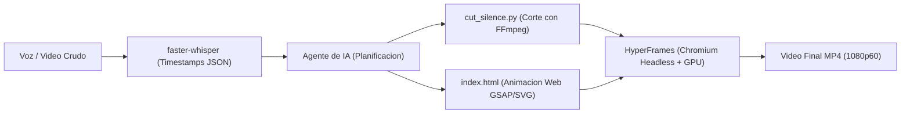

# Video Pipeline

Entorno local automatizado de produccion y edicion de video programatico gobernado por agentes de inteligencia artificial y codigo declarativo.

El sistema resuelve el problema del costo y la friccion de la edicion audiovisual manual mediante una tuberia local que sincroniza modelos de transcripcion temporalizada con motores de composicion web (HTML5, SVG y GSAP) y aceleracion grafica por hardware, operando bajo una politica estricta de **cero costes adicionales**.



---

## 1. Requisitos Previos y Compatibilidad de Entorno

* **Sistema Operativo:** Distribuciones Linux (Debian con Nix Flakes, Ubuntu, Fedora, Arch Linux, NixOS), **Windows 11 nativo** (PowerShell + `winget`) o macOS / WSL2.
* **Controlador Grafico:** Compatible con aceleracion por hardware mediante AMDGPU (VA-API/Mesa) en Linux, AMF/NVENC en Windows, o CPU (`libx264`) si no hay GPU dedicada.
* **FFmpeg:** Version 7.0 o superior instalada en el sistema.
* **Node.js:** Version 20 o 22 LTS y gestor de paquetes `pnpm`.
* **Python:** Version 3.11 o superior (gestionado con `uv`).

### Resumen del Stack Tecnológico

| Capa Técnica | Herramientas Utilizadas | Rol en el Sistema |
| :--- | :--- | :--- |
| **Ingesta y Voz** | `faster-whisper`, `CTranslate2`, `Silero VAD`, `PyAV` | Transcripción de audio a texto con marcas temporales al milisegundo por palabra. |
| **Corte y Ensamblaje** | `FFmpeg 7.x`, `FFprobe` | Poda algorítmica de pausas (`silencedetect`) y multiplexado acelerado por hardware GPU. |
| **Composición Web y 3D** | `HyperFrames`, `GSAP 3.15` (+ `MotionPathPlugin`), `Three.js` (`WebGL`/`GLTFLoader`), `SVG`, `HTML5/CSS3` | Animaciones vectoriales fluidas, cámara 2D sobre lienzo continuo, trazos SVG progresivos, escenas 3D deterministas y control temporal en segundos. |
| **Motor de Render** | `Chrome Headless Shell` (`BeginFrame` API) | Renderizado determinista cuadro a cuadro sin pérdida de fotogramas por sobrecarga. |
| **Entornos y Runtimes** | `uv`, `pnpm`, `Node.js 22 LTS`, `Python 3.13` | Gestión hermética y reproducible de dependencias sin privilegios de superusuario. |

---

## 2. Inicio Rápido (Quickstart)

### Paso 1: Clonar el Repositorio e Inicializar el Entorno Python

**Linux / macOS / WSL2:**
```bash
git clone https://github.com/JorgeDoicela/video-pipeline.git
cd video-pipeline

uv venv .venv
uv pip install --python .venv/bin/python -e ".[dev]"
```

**Windows (PowerShell):**
```powershell
git clone https://github.com/JorgeDoicela/video-pipeline.git
cd video-pipeline

uv venv .venv
uv pip install --python .venv\Scripts\python.exe -e ".[dev]"
```

### Paso 2: Instalar Dependencias de Node.js
```bash
pnpm install
```

### Paso 3: Asegurar el Navegador Headless para Renderizado
```bash
pnpm exec hyperframes browser ensure
```

### Paso 4: Validar la Salud del Sistema
```bash
pnpm run doctor
```

### Paso 5: Ejecutar la Suite de Pruebas Unitarias
```bash
pnpm run test:py
```

### Paso 6: Ejecutar tu Primer Video de Prueba (End-to-End)
```bash
uv run python core/pipeline.py produce \
  -i templates/talking_head_16_9/cut.mp4 \
  -p mi-primer-video \
  -t talking_head_16_9 \
  --title "Hola Mundo Programático" \
  --auto-render
```

El video final quedará disponible en `projects/mi-primer-video/video_mi-primer-video.mp4`.

---

## 3. Modelos de Video, Plantillas y Sistemas de Diseño

El sistema cuenta con **7 plantillas esenciales** (`-t`) y una **arquitectura de diseño componible en 3 niveles** (`-d`, `-s`, `--layout`, `--motion`, `--caption-style`, `--set`):

### 3.1. Catálogo de Plantillas (`templates/`)
* **Vertical 9:16 (TikTok / Reels / Shorts — `1080x1920`):**
  * `explainer_scenes_9_16`: Explainer *faceless* o híbrido multi-escena sincronizado desde `storyboard.json` con atmósfera 2D adaptativa, cámara virtual (`camera_motion`), viñeta/grano (`film_grain`), 30 componentes vectoriales/Canvas/3D/Video/Manim/Cutouts animados (incluidos `infinite_canvas`, `svg_draw`, `scene_3d` con Three.js/WebGL y modelos `.glb` de Blender, `video_clip`, `manim_clip`, `canvas_fx`, `image_cutout` y `custom_scene`), subtítulos `hero_top` o inferiores con `emphasis_words`, y mezcla de voz (`--voice-polish`) + música/cama con *ducking* + 15 SFX.
  * `short_quote_9_16`: Citas, versículos bíblicos, reflexiones y narrativa breve sin código con zonas seguras.
  * `short_tech_9_16`: Tarjeta de código y consola vertical con subtítulos cinéticos.
  * `talking_head_9_16`: Presentador vertical a cámara con zonas seguras calibradas.
* **Horizontal 16:9 (YouTube / Escritorio — `1920x1080`):**
  * `explainer_scenes_16_9`: Explainer widescreen *faceless* o híbrido multi-escena con las mismas 30 primitivas para ensayos, tutoriales, historia, comparativas y métricas.
  * `editorial_16_9`: Narrativa widescreen para ensayos, historia, teología o divulgación con puntos clave.
  * `talking_head_16_9`: Presentador o screencast widescreen con tarjeta *lower-third* y subtítulos cinéticos.

### 3.2. Arquitectura de Diseño Componible en 3 Niveles (`core/styles.py`)
1. **Nivel 1 — Diseños Macro (`-d, --design`):** `cinematic` (defecto), `editorial`, `clean`.
2. **Nivel 2 — Opciones Internas:**
   * **3 Paletas WCAG AA (`-s, --style`):** `dark_violet`, `paper_warm`, `clean_light`.
   * **3 Layouts (`--layout`):** `standard`, `asymmetric_focus`, `stacked`.
   * **3 Perfiles GSAP (`--motion`):** `smooth`, `snappy`, `minimal`.
   * **Estilo de Subtítulos (`--caption-style`):** `minimal_clean` (estándar único limpio sin pastillas).
3. **Nivel 3 — Overrides Granulares (`--set clave=valor`):** Ajuste puntual por proyecto (`accent_primary`, `radius_lg`, `stage_gap`, etc.) persistido en `package.json` (`videoDesign`).

---

## 4. Comandos Principales

| Tarea | Comando | Descripcion Tecnica |
| :--- | :--- | :--- |
| **Pipeline Completo** | `uv run python core/pipeline.py produce -i <raw> -p <slug> -t <tpl> -d <diseño> -s <estilo> --auto-render` | Ejecuta corte (audio o video), transcripción, diseño macro, subtitulado, storyboard (`--storyboard` o `--auto-storyboard`), mezcla SFX, auditoría y renderizado. |
| **Compilar Storyboard** | `uv run python core/pipeline.py storyboard <slug> --mix-sfx` | Compila `storyboard.json` en `index.html` y mezcla SFX + voz opcional (`--audio`) en `audio_mix.wav`. |
| **Gestor de Assets CC0** | `uv run python core/pipeline.py assets <list\|icon\|map\|audio\|model> ...` | Descarga iconos SVG (Iconify), compila mapas reales (Natural Earth GeoJSON), normaliza audio CC0 o importa/valida modelos 3D glTF/GLB en `assets/`. |
| **Procesador de Imágenes** | `uv run python core/pipeline.py image <rembg\|crop\|convert> ...` | Elimina el fondo (IA local ONNX `isnet` 1024x1024 de estudio o color), genera cutouts con borde/sombra, recorta (`9:16`, `16:9`, `--trim`) y convierte formatos (`PNG`, `WEBP`, `JPG`). |
| **Motor Manim (Matemáticas/Algoritmos)** | `uv run python core/pipeline.py manim <doctor\|new\|render\|list> ...` | Crea y renderiza escenas Manim sincronizadas con la paleta del pipeline (`dark_violet`, `paper_warm`, `clean_light`), en `16:9`/`9:16` o fondo transparente, listas para `manim_clip`. |
| **Generación Google Gemini (Opcional)** | `uv run python core/pipeline.py genai <doctor\|image\|video\|tts\|music> ...` | Conector opcional bajo demanda (requiere `GEMINI_API_KEY` y extra `.[genai]`) para generar imágenes (`gemini-nano-banana-2.1`), video MP4 (`gemini-omni-1.2-flash`), voz mono/multi-locutor (`gemini-3.8-flash-tts`) y música (`lyria-3.5`) directos a `assets/`. |
| **Exportar a Editor NLE** | `uv run python core/pipeline.py export-nle <slug> [--split-layers] [--cuts ...]` | Genera paquete editable (`export_nle/`) con clips cortados por escena, capas alfa ProRes 4444/WebM, stems WAV (voz/música/SFX), SRT y `timeline.fcpxml` para DaVinci Resolve / Premiere. |
| **Catálogo de Diseños** | `uv run python core/pipeline.py style --list` | Lista los 3 niveles: Diseños Macro (`-d`), Opciones Internas (`-s`, `--layout`, `--motion`) y Overrides (`--set`). |
| **Perfiles de Canal** | `uv run python core/pipeline.py profiles <list\|show\|init>` | Gestiona perfiles reutilizables por canal o cliente en `profiles/*.json` (`--profile`, `--channel`, `--dated`, `--output-dir`). |
| **Historial de Videos** | `uv run python core/pipeline.py history [--channel <canal>]` | Consulta el registro cronológico `catalog.jsonl` de proyectos creados, producidos y renderizados. |
| **Cambiar Diseño/Opciones** | `uv run python core/pipeline.py style <slug> -d <diseño> --layout <layout> --set <k=v>` | Conmuta entre Diseños Macro, variantes internas o ajustes puntuales sin perder datos. |
| **Inspeccionar Diseño** | `uv run python core/pipeline.py style <slug> --inspect` | Muestra la configuración efectiva de los 3 niveles aplicada sobre un proyecto. |
| **Diagnostico** | `pnpm run doctor` | Verifica dependencias del sistema, GPU, FFmpeg y Chrome cache. |
| **Nuevo Proyecto** | `uv run python core/create_project.py <slug> -t <plantilla> -d <diseño> -s <estilo>` | Inicializa un nuevo proyecto con la plantilla, Diseño Macro y tema visual seleccionados. |
| **Subtítulos Cinéticos**| `uv run python core/sync_captions.py -i <json> --inject <html_path> --caption-style <estilo>` | Convierte timestamps de Whisper a HTML/GSAP con el estilo indicado y exporta SRT/VTT. |
| **Validacion** | `pnpm exec hyperframes check projects/<slug>` | Audita contraste WCAG AA, duracion, tiempos deterministas y layout. |
| **Transcripcion** | `uv run python core/transcribe.py -i <in> -o <out.json>` | Genera marcas de tiempo palabra por palabra con `faster-whisper`. |
| **Corte de Silencios** | `uv run python core/cut_silence.py -i <in> -o <out.mp4>` | Elimina pausas muertas mayores a 0.45s mediante filtros de FFmpeg. |
| **Previsualizacion** | `pnpm exec hyperframes preview projects/<slug>` | Inicia el estudio visual interactivo en `localhost:3002`. |
| **Renderizado MP4** | `pnpm exec hyperframes render projects/<slug> -o <out.mp4>` | Compila la escena web a video MP4 utilizando aceleracion GPU. |
| **Suite de Tests** | `pytest tests` | Ejecuta las pruebas automatizadas de algoritmos y scaffolding. |
| **Auditoria Python** | `ruff check core tests` | Lintea con Ruff asegurando estandares estrictos de tipado y estilo. |
| **Limpieza de Cache** | `pnpm exec hyperframes clean` | Purga fotogramas temporales acumulados en `/tmp`. |

---

## 5. Estructura del Directorio

```text
video-pipeline/
├── assets/                 # Recursos locales reutilizables (SFX, música, fuentes, imágenes, iconos y mapas SVG)
│   ├── audio/             # 15 efectos de sonido WAV (whoosh, pop, click, chime, beep, sub_hit, glitch, scan, drone, shutter, riser, boom, keyclick, powerdown, alarm)
│   ├── music/             # 3 pistas musicales procedurales loopables (tension_pulse, tech_minimal, editorial_warm) y pistas CC0
│   ├── maps/              # 5 mapas geográficos vectoriales SVG (korea, world, europe, americas, asia)
│   ├── images/            # Imágenes procesadas y recortes transparentes (cutouts PNG/WEBP, .gitkeep)
│   ├── models/            # Modelos 3D abiertos glTF/GLB (.glb, .gltf) para el componente scene_3d (.gitkeep)
│   ├── manim/             # Escenas Python de Manim sincronizadas con la paleta del pipeline (5 escenas semilla)
│   ├── videos/            # Clips de video locales, renders Manim y salidas de Gemini Omni (.gitkeep; MP4/WebM ignorados en Git)
│   ├── fonts/             # Tipografías locales del sistema (.gitkeep)
│   └── icons/             # 18 iconos técnicos vectoriales SVG (Docker, K8s, Kafka, Redis, Shield, Lock, Radar, etc.)
├── core/                   # Herramientas del motor compartido
│   ├── __init__.py        # Módulo Python del núcleo
│   ├── _runtime.py        # Inicialización de rutas y entorno virtual local
│   ├── pipeline.py        # Orquestador maestro de producción end-to-end (--no-cut-silence, --no-sfx, --words-per-group)
│   ├── scenes.py          # Motor multi-escena (30 primitivas SVG/HTML/Canvas/3D/Video/Manim + image_cutout, custom_scene, cue_word, hero_top, tree-shaking CSS)
│   ├── audio_mix.py       # Mezclador determinista de voz, música/cama con ducking y 15 SFX (adelay + sidechaincompress + alimiter)
│   ├── styles.py          # Fachada CLI y API del motor de diseño en 3 niveles
│   ├── _styles_catalog.py # Catálogo declarativo de diseños, temas, layouts y tokens
│   ├── _styles_renderer.py# Compilador CSS, mutación HTML y persistencia
│   ├── sync_captions.py   # Motor de subtítulos cinéticos (cortes por puntuación, emphasis_words, SRT/VTT)
│   ├── create_project.py  # Scaffold automatizado a partir de plantillas
│   ├── cut_silence.py     # Algoritmo de poda de silencios (FFmpeg)
│   ├── transcribe.py      # Transcripción local con timestamps y reemplazos multi-palabra (faster-whisper)
│   ├── generate_sfx.py    # Síntesis matemática de 15 SFX WAV y 3 pistas musicales loopables
│   ├── fetch_assets.py    # Gestor de assets abiertos (Iconify SVG + 18 iconos semilla, mapas Natural Earth y audio CC0)
│   ├── image_tools.py     # Procesador de imágenes: rembg (IA local ONNX IS-Net 1024x1024 y color), crop, auto-trim, cutout sticker y conversión
│   ├── manim_tools.py     # Integración Manim Community (doctor, new, render 16:9/9:16/alpha, paleta sincronizada y componente manim_clip)
│   ├── genai_media.py     # Conector opcional bajo demanda para Google Gemini API (Nano Banana, Omni Flash, TTS, Lyria)
│   ├── nle_export.py      # Exportador editable NLE (clips por escena, capas alfa ProRes 4444/WebM, audio stems WAV y timeline.fcpxml)
│   └── workspace.py       # Perfiles de canal/cliente (profiles/*.json), workspaces externos (VIDEO_PIPELINE_WORKSPACE) e historial (catalog.jsonl)
├── profiles/               # Perfiles declarativos reutilizables por canal o cliente (tech_short, editorial_essay, client_clean)
├── tests/                  # Suite de pruebas unitarias automatizadas (pytest)
│   ├── test_audio_mix.py  # Pruebas de síntesis SFX/música y construcción de filter_complex
│   ├── test_fetch_assets.py # Pruebas de Iconify SVG, Natural Earth GeoJSON y audio CC0
│   ├── test_genai_media.py # Pruebas del conector opcional Google Gemini API (offline/sin red)
│   ├── test_image_tools.py # Pruebas de rembg ONNX/color, cutout sticker, crop y conversión
│   ├── test_manim_tools.py # Pruebas de presets Manim, paleta sincronizada y componente manim_clip
│   ├── test_nle_export.py  # Pruebas del exportador FCPXML v1.10, capas alfa y stems WAV
│   ├── test_pipeline.py   # Verificación de interfaces CLI del pipeline
│   ├── test_scaffold.py   # Pruebas de sanitización y scaffolding
│   ├── test_scenes.py     # Pruebas de storyboard, cue_word, componentes y conmutación de diseños
│   ├── test_silence.py    # Pruebas de cálculo de intervalos de silencios
│   ├── test_styles.py     # Pruebas de temas visuales y conmutación no destructiva
│   ├── test_sync_captions.py # Pruebas de segmentación de palabras y GSAP
│   └── test_workspace.py  # Pruebas de perfiles de canal, workspaces externos e historial
├── docs/                   # Biblioteca documental técnica Docs-as-Code
│   ├── 00-indice-general.md
│   ├── 01-arquitectura/
│   │   └── 01-arquitectura-sistema.md
│   ├── 02-nucleo-y-cli/
│   │   └── 01-nucleo-procesamiento.md
│   ├── 03-renderizado-y-formatos/
│   │   ├── 01-motor-renderizado-hyperframes.md
│   │   └── 02-formatos-de-video.md
│   ├── 04-sistema-de-diseno/
│   │   ├── 01-sistema-de-diseno-y-estilos.md
│   │   └── 02-recursos-y-assets.md
│   └── 05-operacion-y-flujos/
│       └── 01-guia-operativa-y-flujos.md
├── templates/              # Catálogo de 7 plantillas esenciales integradas con Design Tokens
│   ├── explainer_scenes_9_16/  # Explainer faceless multi-escena vertical 9:16 (1080x1920)
│   ├── explainer_scenes_16_9/  # Explainer faceless multi-escena horizontal 16:9 (1920x1080)
│   ├── short_quote_9_16/  # TikTok/Reels/Shorts citas, versículos y reflexiones (1080x1920)
│   ├── short_tech_9_16/   # TikTok/Reels/Shorts código y tecnología (1080x1920)
│   ├── talking_head_9_16/ # Presentador vertical 9:16 para Shorts/Reels/TikTok (1080x1920)
│   ├── editorial_16_9/    # Narrativa histórica, bíblica y ensayos en 16:9 (1920x1080)
│   └── talking_head_16_9/ # Presentador widescreen 16:9 con lower-thirds (1920x1080)
├── projects/               # Espacio de trabajo local (ignorado en Git salvo .gitkeep)
├── .agents/                # Directrices de ingeniería y memoria técnica para agentes de IA
│   ├── AGENTS.md
│   └── memory.md
├── .github/workflows/      # Pipeline activo de GitHub Actions (ci.yml)
├── package.json            # Dependencias de HyperFrames y scripts de ejecución
├── pyproject.toml         # Dependencias Python, extras dev, Ruff y pytest
└── README.md              # Guía de entrada y especificación del repositorio
```

---

## 6. Documentación Técnica Detallada (Docs-as-Code)

La documentacion completa del sistema se encuentra organizada bajo taxonomia jerarquica numerica dentro de la carpeta `docs/`.

Consulta el catalogo maestro:
* [Documentación Técnica Completa](docs/00-indice-general.md)

### Indice de Modulos Documentales:
1. [01 — Arquitectura del Sistema](docs/01-arquitectura/01-arquitectura-sistema.md): Separacion en 3 capas (Debian, Nix, Workspace), filosofia de coste cero y topologia del pipeline.
2. [02 — Núcleo de Procesamiento y CLI](docs/02-nucleo-y-cli/01-nucleo-procesamiento.md): Especificacion de `faster-whisper`, esquema de `transcript.json`, filtros de corte en FFmpeg y CLI de orquestacion.
3. [03.1 — Motor de Renderizado (HyperFrames)](docs/03-renderizado-y-formatos/01-motor-renderizado-hyperframes.md): Modelo temporal en segundos, Chromium Headless Shell y aceleracion por hardware GPU.
4. [03.2 — Formatos de Video Soportados](docs/03-renderizado-y-formatos/02-formatos-de-video.md): Contratos de diseño y catalogo de las 7 plantillas esenciales (9:16 y 16:9).
5. [04.1 — Sistema de Diseño y Estilos Componibles](docs/04-sistema-de-diseno/01-sistema-de-diseno-y-estilos.md): Arquitectura de 3 niveles (3 Diseños Macro, 3 Temas WCAG AA, 3 Layouts, 3 Perfiles Motion, subtítulos `minimal_clean` y Overrides `--set`).
6. [04.2 — Recursos Estáticos y Assets](docs/04-sistema-de-diseno/02-recursos-y-assets.md): Efectos de sonido WAV, iconografia tecnica SVG y tipografias locales.
7. [05 — Guía Operativa y Flujos de Trabajo](docs/05-operacion-y-flujos/01-guia-operativa-y-flujos.md): Runbooks secuenciales desde la grabacion hasta la exportacion final.

---

## 7. Seguridad y Licencia

* **Gestion de Secretos:** Este entorno no almacena claves privadas ni tokens de pago. Toda la inferencia y procesamiento se ejecuta de manera local y desconectada.
* **Licencia:** El entorno se compone de herramientas de codigo abierto bajo licencia [MIT](LICENSE).
