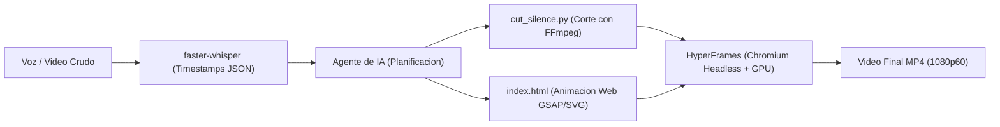

# Video Pipeline

Entorno local automatizado de produccion y edicion de video programatico gobernado por agentes de inteligencia artificial y codigo declarativo.

El sistema resuelve el problema del costo y la friccion de la edicion audiovisual manual mediante una tuberia local que sincroniza modelos de transcripcion temporalizada con motores de composicion web (HTML5, SVG y GSAP) y aceleracion grafica por hardware, operando bajo una politica estricta de **cero costes adicionales**.



---

## 1. Requisitos Previos y Compatibilidad de Entorno

* **Sistema Operativo:** Distribuciones Linux (Debian, Ubuntu, Fedora, Arch Linux, NixOS) o entornos con soporte Chromium/FFmpeg (WSL2 / macOS).
* **Controlador Grafico:** Compatible con aceleracion por hardware mediante AMDGPU (VA-API/Mesa), Intel QuickSync o NVIDIA (NVENC/CUDA). Opcionalmente corre en modo software sobre CPU si no hay GPU dedicada.
* **FFmpeg:** Version 7.0 o superior instalada en el sistema.
* **Node.js:** Version 20 o 22 LTS y gestor de paquetes `pnpm`.
* **Python:** Version 3.10 o superior (gestionado con `uv`).

### Resumen del Stack Tecnológico

| Capa Técnica | Herramientas Utilizadas | Rol en el Sistema |
| :--- | :--- | :--- |
| **Ingesta y Voz** | `faster-whisper`, `CTranslate2`, `Silero VAD`, `PyAV` | Transcripción de audio a texto con marcas temporales al milisegundo por palabra. |
| **Corte y Ensamblaje** | `FFmpeg 7.x`, `FFprobe` | Poda algorítmica de pausas (`silencedetect`) y multiplexado acelerado por hardware GPU. |
| **Composición Web** | `HyperFrames`, `GSAP 3.15`, `SVG`, `HTML5/CSS3` | Animaciones vectoriales fluidas, tipografía cinética y control temporal en segundos. |
| **Motor de Render** | `Chrome Headless Shell` (`BeginFrame` API) | Renderizado determinista cuadro a cuadro sin pérdida de fotogramas por sobrecarga. |
| **Entornos y Runtimes** | `uv`, `pnpm`, `Node.js 22 LTS`, `Python 3.13` | Gestión hermética y reproducible de dependencias sin privilegios de superusuario. |

---

## 2. Inicio Rápido (Quickstart)

### Paso 1: Clonar el Repositorio e Inicializar el Entorno Python
```bash
git clone https://github.com/JorgeDoicela/video-pipeline.git
cd video-pipeline

# Crear entorno virtual aislado e instalar dependencias
uv venv .venv
uv pip install --python .venv/bin/python -r requirements.txt
```

### Paso 2: Instalar Dependencias de Node.js
```bash
pnpm install
```

### Paso 3: Asegurar el Navegador Headless para Renderizado
```bash
pnpm exec hyperframes browser ensure
```

### Paso 4: Validar la Salud del Sistema
```bash
pnpm exec hyperframes doctor
```

---

## 3. Modelos de Video Soportados

El sistema esta diseñado para producir dos formatos de contenido:

1. **Formato 1: Grabacion a Camara o Pantalla (Talking Head / Screencast):**
   * Poda algoritmica automatica de silencios y pausas mayores a 400 ms con FFmpeg.
   * Superposicion de subtitulos cineticos palabra por palabra sincronizados con el audio.
   * Tarjetas flotantes (*lower-thirds*) para resaltar conceptos, rutas y comandos de terminal.

2. **Formato 2: Explicador Tecnico Abstracto (Sin Rostro):**
   * Generacion procedural de diagramas de arquitectura de sistemas (cajas de servidores, clientes, bases de datos).
   * Animacion de flujo de datos y paquetes de red mediante lineas vectoriales SVG y GSAP.
   * Bloques de codigo fuente con resaltado de sintaxis dinamico sincronizados con la explicacion de voz en off.

### Relaciones de Aspecto y Redes Sociales

El motor renderiza en cualquier relacion de aspecto sin alterar los tiempos de animacion:
* **9:16 Vertical (`1080x1920`):** TikTok, Instagram Reels y YouTube Shorts (con zonas seguras de interfaz ya calibradas).
* **16:9 Horizontal (`1920x1080`):** YouTube estandar, LinkedIn Video y presentaciones widescreen.
* **1:1 Cuadrado (`1080x1080`):** Publicaciones de alto impacto para timelines de LinkedIn e Instagram.
* **4:5 Feed Vertical (`1080x1350`):** Formato optimizado para el feed movil de Instagram.

---

## 4. Comandos Principales

| Tarea | Comando | Descripcion Tecnica |
| :--- | :--- | :--- |
| **Diagnostico** | `pnpm exec hyperframes doctor` | Verifica dependencias del sistema, GPU, FFmpeg y Chrome cache. |
| **Transcripcion** | `.venv/bin/python core/transcribe.py -i <in> -o <out.json>` | Genera marcas de tiempo palabra por palabra con `faster-whisper`. |
| **Corte de Silencios** | `core/cut_silence.py -i <in> -o <out.mp4>` | Elimina pausas muertas mayores a 0.45s mediante filtros de FFmpeg. |
| **Previsualizacion** | `pnpm exec hyperframes preview` | Inicia el estudio visual interactivo en `localhost:3000`. |
| **Renderizado MP4** | `pnpm exec hyperframes render -o <out.mp4>` | Compila la escena web a video MP4 utilizando aceleracion GPU. |
| **Limpieza de Cache** | `pnpm exec hyperframes clean` | Purga fotogramas temporales acumulados en `/tmp`. |

---

## 5. Estructura del Directorio

```text
video-pipeline/
├── assets/                 # Recursos locales reutilizables
│   ├── audio/             # Efectos de sonido libres (WAV/MP3)
│   ├── fonts/             # Tipografías del sistema
│   └── icons/             # Iconos vectoriales en formato SVG
├── core/                   # Herramientas del motor compartido
│   ├── transcribe.py      # Transcripción local con timestamps (faster-whisper)
│   └── cut_silence.py     # Algoritmo de poda de silencios (FFmpeg)
├── docs/                   # Biblioteca documental técnica Docs-as-Code
│   ├── 00-indice-general.md
│   ├── 01-arquitectura-sistema.md
│   ├── 02-nucleo-procesamiento.md
│   ├── 03-motor-renderizado-hyperframes.md
│   ├── 04-formatos-de-video.md
│   └── 05-guia-operativa-y-flujos.md
├── templates/              # Plantillas base para generación por IA
│   ├── portrait_9_16/     # TikTok, Reels, Shorts (1080x1920 con Safe Zones)
│   ├── landscape_16_9/    # YouTube y Desktop (1920x1080 Widescreen)
│   ├── square_1_1/        # Feeds de Instagram y LinkedIn (1080x1080)
│   ├── talking_head/      # Overlays, subtítulos cinéticos y lower-thirds
│   └── tech_explainer/    # Diagramas de infraestructura SVG y bloques de código
├── projects/               # Espacio de trabajo para producciones individuales
│   └── demo/              # Proyecto piloto validado funcionalmente
├── package.json           # Dependencias de HyperFrames y scripts de ejecución
├── requirements.txt       # Dependencias fijadas del runtime de Python
└── README.md              # Guía de entrada y especificación del repositorio
```

---

## 6. Documentación Técnica Detallada (Docs-as-Code)

La documentacion completa del sistema se encuentra organizada bajo taxonomia jerarquica numerica dentro de la carpeta `docs/`.

Consulta el catalogo maestro:
* [Documentación Técnica Completa](docs/00-indice-general.md)

### Indice de Modulos Documentales:
1. [01 — Arquitectura del Sistema](docs/01-arquitectura-sistema.md): Separacion en 3 capas (Debian, Nix, Workspace), filosofia de coste cero y topologia del pipeline.
2. [02 — Núcleo de Procesamiento de Medios](docs/02-nucleo-procesamiento.md): Especificacion de `faster-whisper`, esquema de `transcript.json` y filtros de corte en FFmpeg.
3. [03 — Motor de Renderizado (HyperFrames)](docs/03-motor-renderizado-hyperframes.md): Modelo temporal en segundos, Chromium Headless Shell y aceleracion por hardware GPU.
4. [04 — Formatos de Video Soportados](docs/04-formatos-de-video.md): Contratos de diseño para Talking Head y Explicaciones Tecnicas con SVG.
5. [05 — Guía Operativa y Flujos de Trabajo](docs/05-guia-operativa-y-flujos.md): Runbooks secuenciales desde la grabacion hasta la exportacion final.

---

## 7. Seguridad y Licencia

* **Gestion de Secretos:** Este entorno no almacena claves privadas ni tokens de pago. Toda la inferencia y procesamiento se ejecuta de manera local y desconectada.
* **Licencia:** El entorno se compone de herramientas de codigo abierto bajo licencia [MIT](LICENSE).
