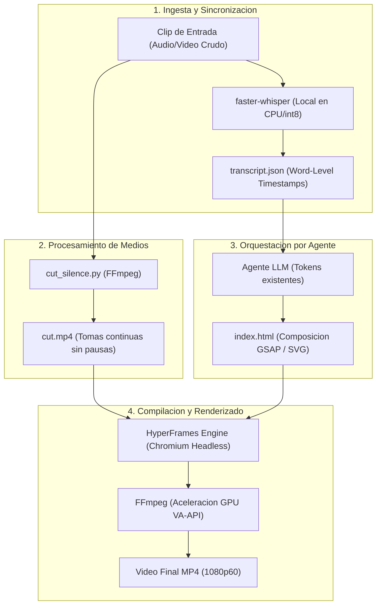

# 01 — Arquitectura del Sistema

Este documento describe la arquitectura global del sistema de generacion de video programatico mediante agentes de inteligencia artificial y su integracion con las capas del sistema operativo.

---

## 1. Vision General del Sistema

El sistema implementa una tuberia automatizada de produccion audiovisual orientada a sustituir la edicion manual por generacion declarativa mediante codigo y modelos locales de lenguaje:

---

## 2. Separacion de Responsabilidades en 3 Capas

Para garantizar la estabilidad grafica y la inmutabilidad de la estacion de trabajo, el pipeline se distribuye en tres niveles tecnicos:

| Nivel | Gestor | Componentes | Justificacion de Ingenieria |
| :--- | :--- | :--- | :--- |
| **Capa 1: Sistema Base** | Debian (`apt` + `/usr/bin/`) | `ffmpeg 7.1.5`, controladores Mesa (`radeonsi_dri.so`), VA-API y subsistema DRM. | **Acceso nativo a GPU sin desajuste de ABI:** La codificacion y decodificacion de video acelerada por hardware requiere enlace directo con el kernel Linux y los controladores graficos de Debian. |
| **Capa 2: Entorno Declarativo** | Nix Flakes + Home Manager | `nodejs_22`, `pnpm`, `uv` (en `modules/apps.nix`). | **Hermetismo y Reproducibilidad:** Gestores de paquetes y runtimes de desarrollo CLI puros, fijados criptograficamente en `flake.lock` para garantizar identico comportamiento en todas las laptops. |
| **Capa 3: Espacio de Proyecto** | Usuario local (`video-pipeline/`) | Entorno virtual `.venv` (`faster-whisper`), dependencias locales (`hyperframes`), proyectos y assets. | **Cero Contaminacion:** Las librerias de IA y modelos preentrenados quedan aislados en el espacio de usuario, sin requerir privilegios de superusuario ni alterar paquetes del sistema. |

---

## 3. Inventario Exhaustivo de Herramientas del Pipeline

A continuacion se detalla la totalidad de herramientas, runtimes, motores y bibliotecas que componen la arquitectura:

| Herramienta / Paquete | Version Referencia | Categoria / Rol Tecnico | Licencia | Funcion Exacta en el Pipeline |
| :--- | :--- | :--- | :--- | :--- |
| **FFmpeg** | `7.1.5` | Motor de Medios y Codecs | LGPL / GPL | Deteccion de silencios (`silencedetect`), corte algoritmico (`trim/atrim`), ensamblaje (`concat`) y multiplexado final. |
| **FFprobe** | `7.1.5` | Inspeccion de Streams | LGPL / GPL | Extraccion de metadatos de duracion, canales y formato de video/audio sin decodificacion completa. |
| **faster-whisper** | `1.2.1` | Transcripcion Speech-to-Text | MIT | Extraccion de coordenadas temporales exactas palabra por palabra (*word-level timestamps*) en formato JSON. |
| **CTranslate2** | `4.8.5` | Motor de Inferencia Neuronal | MIT | Aceleracion de modelos Whisper en CPU mediante cuantizacion `int8` y multi-threading. |
| **Silero VAD** | Integrado en Whisper | Deteccion de Actividad Vocal | MIT | Filtro de voz que descarta segmentos sin fonacion para evitar alucinaciones del modelo de lenguaje. |
| **PyAV (`av`)** | `13.1.0` | Bindings Python de FFmpeg | BSD | Decodificacion y manipulacion de streams de audio directamente en memoria para alimentar a Whisper. |
| **Node.js** | `22.x LTS` | Runtime JavaScript del Servidor | MIT | Entorno de ejecucion para la CLI de HyperFrames y los workers paralelos de renderizado. |
| **pnpm** | `12.x` | Gestor de Paquetes Node | MIT | Gestion eficiente de dependencias mediante enlaces duros en Content-Addressable Store. |
| **Python** | `3.13 / 3.10+` | Runtime de Scripts de Procesamiento | PSF | Ejecucion de los scripts de ingesta y orquestacion de FFmpeg (`transcribe.py` y `cut_silence.py`). |
| **uv** | `0.13.4` | Gestor de Entornos Python | Apache 2.0 / MIT | Creacion ultra-rapida y determinista del entorno virtual `.venv` y resolucion de paquetes sin privilegios `sudo`. |
| **HyperFrames** | `0.9.14+` | Motor de Renderizado Programatico | Apache 2.0 | Compilador de escenas web a video MP4, orquestador de workers y servidor de previsualizacion en vivo. |
| **Chrome Headless Shell** | `v152.0+` | Navegador Headless de Captura | BSD / Chromium | Renderizado cuadro a cuadro determinista via `BeginFrame` API sin perdida de fotogramas por sobrecarga. |
| **GSAP** | `3.15.0` | Motor de Animacion y Timelines | Estandar Web (CDN) | Interpolacion de movimientos, fisicas de aceleracion (*easing*), sincronizacion temporal y transformaciones vectoriales. |
| **SVG** | W3C Standard | Graficos Vectoriales Dinamicos | Abierto | Representacion procedural de nodos, redes, conexiones Bezier, paquetes de datos y filtros de resplandor (*bloom*). |
| **Prism.js** | CDN / Modular | Resaltado de Sintaxis | MIT | Formateo visual y coloreado sintactico de bloques de codigo en Formato 2. |
| **Ruff** | `0.9.x` | Linter y Formateador Python | MIT | Verificación estática de código, tipado, optimización de imports y estilo PEP8. |
| **pytest** | `9.x` | Framework de Pruebas Unitarias | MIT | Ejecución de tests automatizados de algoritmos de audio, recorte y scaffolding. |
| **Git** | `2.x` | Control de Versiones | GPLv2 | Trazabilidad del codigo, configuraciones de proyectos y gestion de cambios. |
| **GitHub CLI (`gh`)** | `2.x` | Automatizacion de Repositorio Remoto | MIT | Publicacion remota, sincronizacion y autenticacion sin interaccion grafica. |

---

## 4. Filosofia de Coste Cero

El pipeline se adhiere a una politica estricta de **cero costes adicionales**:

1. **Inferencia de Audio Local:** La transcripcion temporalizada se ejecuta en local mediante `faster-whisper` (basado en CTranslate2), eliminando la dependencia de APIs comerciales de audio.
2. **Generacion Vectorial por Codigo:** Los recursos visuales, esquemas de sistemas y elementos tipograficos se generan como codigo fuente web (HTML5, SVG y CSS3), prescindiendo de servicios de generacion de video por GPU en la nube.
3. **Efectos de Sonido Locales:** Los efectos sonoros (SFX) se vinculan desde paquetes locales con licencias de uso libre (Creative Commons), descartando servicios de sintetizacion de audio de pago por caracter.
4. **Licenciamiento Libre:** HyperFrames opera bajo licencia Apache 2.0 y FFmpeg bajo LGPL/GPL, permitiendo su uso sin restricciones de licenciamiento comercial.

---

## 5. Enlaces Relacionados

* Consultar la especificacion del nucleo de audio en [02-nucleo-procesamiento.md](./02-nucleo-procesamiento.md).
* Consultar la arquitectura de HyperFrames en [03-motor-renderizado-hyperframes.md](./03-motor-renderizado-hyperframes.md).
* Volver al catalogo maestro en [00-indice-general.md](./00-indice-general.md).
