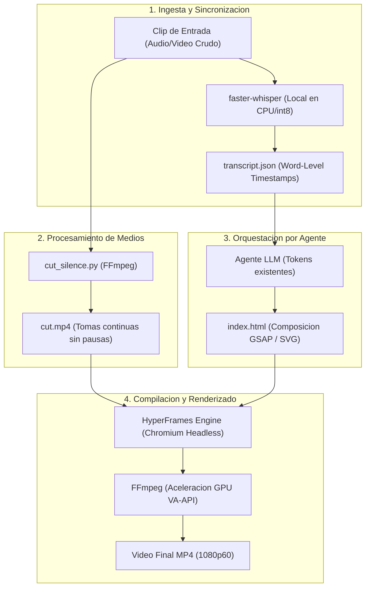

# 01 — Arquitectura del Sistema

Este documento describe la arquitectura global del sistema de generacion de video programatico mediante agentes de inteligencia artificial y su integracion con las capas del sistema operativo.

---

## 1. Vision General del Sistema

El sistema implementa una tuberia automatizada de produccion audiovisual orientada a sustituir la edicion manual por generacion declarativa mediante codigo y modelos locales de lenguaje:

---

## 2. Separacion de Responsabilidades en 3 Capas

Para garantizar la estabilidad grafica y la inmutabilidad de la estacion de trabajo, el pipeline se distribuye en tres niveles tecnicos:

| Nivel | Gestor | Componentes | Justificacion de Ingenieria |
| :--- | :--- | :--- | :--- |
| **Capa 1: Sistema Base** | Debian (`apt` + `/usr/bin/`) | `ffmpeg 7.1.5`, controladores Mesa (`radeonsi_dri.so`), VA-API y subsistema DRM. | **Acceso nativo a GPU sin desajuste de ABI:** La codificacion y decodificacion de video acelerada por hardware requiere enlace directo con el kernel Linux y los controladores graficos de Debian. |
| **Capa 2: Entorno Declarativo** | Nix Flakes + Home Manager | `nodejs_22`, `pnpm`, `uv` (en `modules/apps.nix`). | **Hermetismo y Reproducibilidad:** Gestores de paquetes y runtimes de desarrollo CLI puros, fijados criptograficamente en `flake.lock` para garantizar identico comportamiento en todas las laptops. |
| **Capa 3: Espacio de Proyecto** | Usuario local (`video-pipeline/`) | Entorno virtual `.venv` (`faster-whisper`), dependencias locales (`hyperframes`), proyectos y assets. | **Cero Contaminacion:** Las librerias de IA y modelos preentrenados quedan aislados en el espacio de usuario, sin requerir privilegios de superusuario ni alterar paquetes del sistema. |

---

## 3. Filosofia de Coste Cero

El pipeline se adhiere a una politica estricta de **cero costes adicionales**:

1. **Inferencia de Audio Local:** La transcripcion temporalizada se ejecuta en local mediante `faster-whisper` (basado en CTranslate2), eliminando la dependencia de APIs comerciales de audio.
2. **Generacion Vectorial por Codigo:** Los recursos visuales, esquemas de sistemas y elementos tipograficos se generan como codigo fuente web (HTML5, SVG y CSS3), prescindiendo de servicios de generacion de video por GPU en la nube.
3. **Efectos de Sonido Locales:** Los efectos sonoros (SFX) se vinculan desde paquetes locales con licencias de uso libre (Creative Commons), descartando servicios de sintetizacion de audio de pago por caracter.
4. **Licenciamiento Libre:** HyperFrames opera bajo licencia Apache 2.0 y FFmpeg bajo LGPL/GPL, permitiendo su uso sin restricciones de licenciamiento comercial.

---

## 4. Enlaces Relacionados

* Consultar la especificacion del nucleo de audio en [02-nucleo-procesamiento.md](./02-nucleo-procesamiento.md).
* Consultar la arquitectura de HyperFrames en [03-motor-renderizado-hyperframes.md](./03-motor-renderizado-hyperframes.md).
* Volver al catalogo maestro en [00-indice-general.md](./00-indice-general.md).
