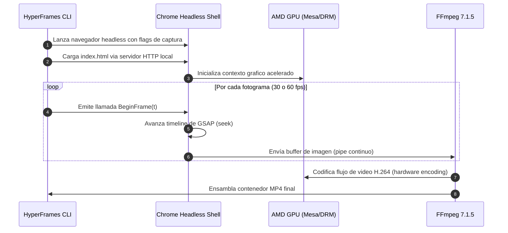

# 03 — Motor de Renderizado (HyperFrames)

Este documento detalla la arquitectura, el modelo temporal y el ciclo de vida de renderizado del motor **HyperFrames** en el entorno local.

---

## 1. Principios de Diseño de HyperFrames

HyperFrames es un motor de renderizado de video programatico basado en estandares web modernos:

* **Sin Etapas de Compilacion Pesadas:** A diferencia de frameworks basados en React (como Remotion), HyperFrames opera directamente sobre un archivo `index.html` estandar con dependencias en linea o cargadas via CDN local.
* **Modelo Temporal en Segundos:** El tiempo no se gestiona como fotogramas discretos (`useCurrentFrame()`), sino mediante coordenadas de tiempo real absoluto en segundos (`data-start="1.5"` y `data-duration="3.0"`), reduciendo el desajuste al traducir marcas temporales de modelos de audio.
* **Control de Animacion con GSAP:** Las interpolaciones y curvas de aceleracion (*easing*) se delegan a GSAP (GreenSock Animation Platform), garantizando movimientos suaves y reproducibilidad milimetrica.

---

## 2. Anatomia de una Composicion (`index.html`)

Una composicion basica de HyperFrames se estructura en tres partes:

```html
<!doctype html>
<html lang="es">
  <head>
    <meta charset="UTF-8" />
    <meta name="viewport" content="width=1920, height=1080" />
    <script src="https://cdn.jsdelivr.net/npm/gsap@3.15.0/dist/gsap.min.js"></script>
    <style>
      body {
        margin: 0;
        width: 1920px;
        height: 1080px;
        background: #0f172a;
        color: #f8fafc;
        overflow: hidden;
      }
      #root {
        width: 100%;
        height: 100%;
        display: flex;
        align-items: center;
        justify-content: center;
      }
    </style>
  </head>
  <body>
    <!-- Contenedor principal de la composicion -->
    <div
      id="root"
      data-composition-id="main"
      data-start="0"
      data-duration="10"
      data-width="1920"
      data-height="1080"
    >
      <div id="card" class="clip" data-start="1.0" data-duration="4.0">
        <h1>Arquitectura Distribuida</h1>
      </div>
    </div>

    <script>
      // Linea de tiempo sincronizada con el motor de render
      const tl = gsap.timeline({ paused: true });
      
      tl.fromTo("#card", 
        { opacity: 0, y: 50 }, 
        { opacity: 1, y: 0, duration: 0.6, ease: "power3.out" }, 
        1.0
      );

      // Registro obligatorio de la linea de tiempo
      window.__timelines = window.__timelines || {};
      window.__timelines["main"] = tl;
      tl.seek(0);
    </script>
  </body>
</html>
```

---

## 3. Pipeline de Renderizado Headless

El proceso de conversion de codigo HTML a video MP4 sigue una secuencia determinista:



### Caracteristicas del Motor de Render:
1. **Captura `BeginFrame`:** Chrome Headless Shell no graba la pantalla en tiempo real (lo cual generaria caidas de fotogramas si el sistema se satura). En su lugar, el renderizador emite una peticion explicita por cada cuadro, garantizando que ningun fotograma se pierda independientemente de la carga de CPU.
2. **Workers Paralelos:** HyperFrames detecta los nucleos de la CPU (8 hilos en Ryzen 3 5300U) para distribuir la captura en multiples instancias simultaneas de Chromium.

---

## 4. Comandos de la CLI de HyperFrames

| Comando | Funcion |
| :--- | :--- |
| `pnpm exec hyperframes preview` | Inicia el estudio visual local con servidor de desarrollo y linea de tiempo interactiva. |
| `pnpm exec hyperframes render -o out.mp4` | Compila la composicion de la carpeta actual a un archivo MP4 final. |
| `pnpm exec hyperframes render --format webm -o out.webm` | Compila con canal alfa transparente (ideal para superponer sobre un video base). |
| `pnpm exec hyperframes check` | Valida errores de JavaScript, contraste de color y assets ausentes en Chrome Headless. |
| `pnpm exec hyperframes doctor` | Verifica el estado de dependencias del sistema (Node.js, Chrome, FFmpeg, GPU). |

---

## 5. Enlaces Relacionados

* Ver la especificacion de los formatos visuales en [04-formatos-de-video.md](./04-formatos-de-video.md).
* Ver los procedimientos paso a paso en [05-guia-operativa-y-flujos.md](./05-guia-operativa-y-flujos.md).
