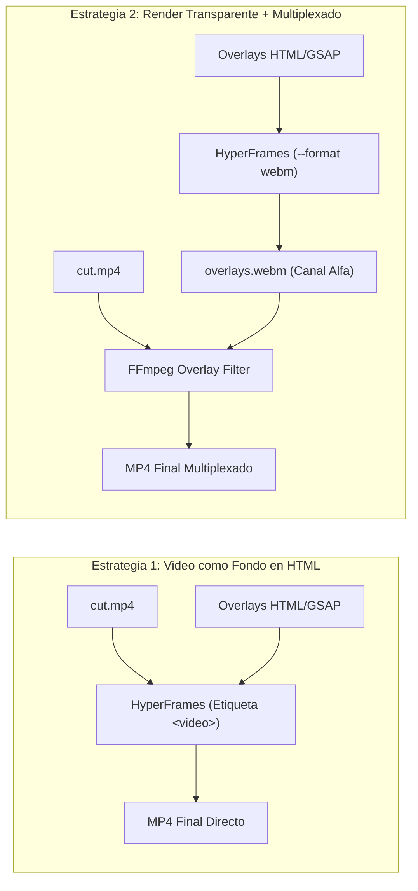

# 04 — Formatos de Video Soportados

Este documento define la especificacion de diseño, contratos tecnicos y ejemplos de codigo para los dos formatos de video que produce el pipeline.

---

## 1. Formato 1: Grabacion a Camara y Pantalla (Talking Head)

* **Proposito:** Videos donde el autor expone un tema en camara o comparte su escritorio, enriquecido con elementos graficos dinamicos sincronizados con el habla.
* **Componentes Visuales:**
  1. **Subtitulos Cineticos:** Palabras individuales que aparecen o cambian de color en el milisegundo exacto de su pronunciacion (estilo tipografia cinetica).
  2. **Tarjetas Flotantes (*Lower-Thirds*):** Paneles informativos con definiciones, comandos de consola o advertencias tecnicas.
  3. **Llamadas de Atencion:** Recuadros, flechas o efectos de zoom focalizados sobre elementos de la grabacion de pantalla.

### 1.1. Arquitectura de Composicion de Capas

Existen dos estrategias tecnicas para ensamblar este formato:



* **Estrategia Recomendada:** La *Estrategia 1* (incrustar el video crudo recortado directamente en la composicion de HyperFrames mediante `<video src="cut.mp4">`) permite al motor de Chrome sincronizar el fotograma exacto del video con las animaciones de texto sin requerir pasadas adicionales de multiplexado en FFmpeg.

### 1.2. Patron de Composicion HTML para Formato 1

```html
<!doctype html>
<html lang="es">
  <head>
    <meta charset="UTF-8" />
    <meta name="viewport" content="width=1920, height=1080" />
    <script src="https://cdn.jsdelivr.net/npm/gsap@3.15.0/dist/gsap.min.js"></script>
    <style>
      body { margin: 0; width: 1920px; height: 1080px; overflow: hidden; background: #000; font-family: sans-serif; }
      #root { position: relative; width: 100%; height: 100%; }
      #bg-video { position: absolute; top: 0; left: 0; width: 100%; height: 100%; object-fit: cover; }
      .lower-third {
        position: absolute; bottom: 80px; left: 80px;
        background: rgba(15, 23, 42, 0.88); backdrop-filter: blur(12px);
        border-left: 6px solid #38bdf8; padding: 20px 32px; border-radius: 8px; color: #fff;
        opacity: 0; transform: translateY(30px);
      }
      .kinetic-caption {
        position: absolute; bottom: 220px; width: 100%; text-align: center;
        font-size: 54px; font-weight: 800; color: #f8fafc; text-shadow: 0 4px 16px rgba(0,0,0,0.8);
      }
      .word { opacity: 0.3; }
      .word.active { opacity: 1; color: var(--accent-primary, #38bdf8); }
    </style>
  </head>
  <body>
    <div id="root" data-composition-id="main" data-style="cyber_dark" data-start="0" data-duration="15" data-width="1920" data-height="1080">
      <video id="bg-video" src="cut.mp4" data-start="0" data-duration="15" muted></video>
      <div id="card" class="lower-third">
        <h3 style="margin:0 0 6px 0; font-size: 28px;">Base de Datos Distribuida</h3>
        <p style="margin:0; font-size: 18px; color: #94a3b8;">Consistencia eventual y particionamiento</p>
      </div>
      <div class="kinetic-caption">
        <span id="w1" class="word">Bienvenidos</span>
        <span id="w2" class="word">al</span>
        <span id="w3" class="word">sistema</span>
      </div>
    </div>
    <script>
      const tl = gsap.timeline({ paused: true });
      // Sincronizacion de lower-third (segundo 2.5 al 6.0)
      tl.to("#card", { opacity: 1, y: 0, duration: 0.4, ease: "power2.out" }, 2.5);
      tl.to("#card", { opacity: 0, y: 20, duration: 0.3, ease: "power2.in" }, 6.0);
      // Sincronizacion palabra por palabra con timestamps de Whisper
      tl.to("#w1", { className: "word active", duration: 0.05 }, 1.1);
      tl.to("#w2", { className: "word active", duration: 0.05 }, 1.4);
      tl.to("#w3", { className: "word active", duration: 0.05 }, 1.7);
      window.__timelines = { main: tl };
      tl.seek(0);
    </script>
  </body>
</html>
```

---

## 2. Formato 2: Explicador Tecnico Abstracto (Sin Rostro)

* **Proposito:** Videos de alta densidad tecnica donde la voz en off guia la visualizacion de conceptos de software, flujos de paquetes en redes, arquitectura de microservicios o estructuras de datos.
* **Motor Grafico Principal:** HyperFrames con SVG y Prism.js.

### 2.1. Modelado de Diagramas de Arquitectura con SVG
El agente genera codigo SVG donde los elementos de infraestructura se representan como nodos y aristas:
* **Nodos:** Rectangulos con bordes redondeados y texto tipografico que representan servidores, microservicios, bases de datos o clientes.
* **Conexiones:** Lineas vectoriales con `stroke-dasharray` y `stroke-dashoffset` animados con GSAP para simular flujo continuo de datos o paquetes de red.
* **Resaltado de Codigo:** Bloques `<pre><code>` estilizados con temas de alto contraste, donde GSAP activa el resaltado de lineas especificas al momento en que la voz las explica.

### 2.2. Patron de Animacion SVG para Formato 2

```html
<svg width="1920" height="1080" viewBox="0 0 1920 1080" style="background:#090d16;">
  <!-- Nodo Cliente -->
  <g id="client-node" transform="translate(300, 480)">
    <rect width="240" height="120" rx="12" fill="#1e293b" stroke="#38bdf8" stroke-width="3"/>
    <text x="120" y="68" fill="#f8fafc" font-size="22" font-weight="600" text-anchor="middle">Cliente Web</text>
  </g>

  <!-- Canal de Red -->
  <line id="network-cable" x1="540" y1="540" x2="1380" y2="540" stroke="#334155" stroke-width="6"/>

  <!-- Paquete de Datos Viajando -->
  <circle id="tcp-packet" cx="540" cy="540" r="14" fill="#38bdf8" opacity="0"/>

  <!-- Nodo Servidor API -->
  <g id="server-node" transform="translate(1380, 480)">
    <rect width="240" height="120" rx="12" fill="#1e293b" stroke="#10b981" stroke-width="3"/>
    <text x="120" y="68" fill="#f8fafc" font-size="22" font-weight="600" text-anchor="middle">Servidor API</text>
  </g>
</svg>
<script>
  // En GSAP se anima el envio del paquete de red
  tl.set("#tcp-packet", { opacity: 1 }, 2.0);
  tl.fromTo("#tcp-packet", { cx: 540 }, { cx: 1380, duration: 1.2, ease: "power1.inOut" }, 2.0);
  tl.set("#tcp-packet", { opacity: 0 }, 3.2);
</script>
```

---

## 3. Matriz de Seleccion de Motor

| Caracteristica | Formato 1 (Talking Head) | Formato 2 (Arquitectura/Redes) | Formato 2 (Matematicas/Calculo) |
| :--- | :--- | :--- | :--- |
| **Pista Visual Base** | Grabacion de camara o pantalla | Vacia (generada por codigo) | Vacia (generada por codigo) |
| **Motor Recomendado** | HyperFrames (HTML + GSAP) | HyperFrames (HTML + SVG + GSAP) | Manim (Python / Cairo) |
| **Tiempo de Render** | 0.6x - 1.0x tiempo real | 0.3x - 0.7x tiempo real | 1.5x - 3.0x tiempo real |
| **Manejo de Subtitulos** | Nativo mediante timestamps | Opcional | Raramente utilizado |

---

## 4. Relaciones de Aspecto y Optimizacion para Redes Sociales

El pipeline permite renderizar en cualquier relacion de aspecto ajustando los atributos `data-width` y `data-height` en la composicion HTML:

| Formato | Resolucion | Aspect Ratio | Plataformas Destino | Consideraciones de Zona Segura (Safe Zones) |
| :--- | :--- | :--- | :--- | :--- |
| **Portrait (Vertical)** | `1080x1920` | 9:16 | TikTok, Instagram Reels, YouTube Shorts | Reservar 220px arriba (interfaz de usuario), 350px abajo (descripcion y perfil) y 140px a la derecha (botones de interaccion social). |
| **Landscape (Horizontal)** | `1920x1080` | 16:9 | YouTube, LinkedIn Video, X (Twitter), Web | Widescreen completo. Ideal para terminales anchas, arquitectura de sistemas y presentaciones de diapositivas. |
| **Square (Cuadrado)** | `1080x1080` | 1:1 | Instagram Feed, LinkedIn Feed | Lectura equilibrada en timelines de escritorio y movil. Maxima atencion en publicaciones estaticas con video integrado. |
| **Feed Portrait** | `1080x1350` | 4:5 | Instagram Post Feed | Maxima cobertura vertical dentro del feed estandar de Instagram sin entrar al visor de Reels. |

### 4.1. Catálogo Completo de las 9 Plantillas Disponibles en `templates/`

Para cubrir múltiples tipologías de videos técnicos, educativos y de divulgación sin diseñar desde cero, el directorio `templates/` proporciona **9 plantillas especializadas**, todas integradas al 100% con el motor de 3 niveles de diseño ([`core/styles.py`](../core/styles.py)):

| Plantilla (`-t`) | Resolución / Ratio | Categoría | Componentes y Estructura Visual |
| :--- | :--- | :--- | :--- |
| `landscape_16_9` | `1920x1080` (16:9) | Comparativa / Widescreen | Escenario dividido en dos paneles (`split-stage`) para contrastar arquitecturas, patrones o antes/después en YouTube. |
| `portrait_9_16` | `1080x1920` (9:16) | Social Vertical (Sin Rostro) | Zonas seguras calibradas para Shorts/Reels/TikTok, ventana de código central y contenedor de subtítulos cinéticos a `y: 1420px`. |
| `square_1_1` | `1080x1080` (1:1) | Microlearning Feed | Formato cuadrado 1:1 con ventana técnica central para publicaciones de alto impacto en feeds de LinkedIn e Instagram. |
| `feed_4_5` | `1080x1350` (4:5) | Feed Móvil Vertical | Formato 4:5 que maximiza el área vertical en timelines móviles de LinkedIn e Instagram con ventana de código y tarjetas de métricas KPI. |
| `talking_head` | `1920x1080` (16:9) | Presentador Widescreen | Video de cámara o screencast a pantalla completa (`cut.mp4`), tarjeta *lower-third* animada y subtítulos cinéticos sincronizados. |
| `talking_head_9_16` | `1080x1920` (9:16) | Presentador Vertical | Video de presentador vertical para Shorts/Reels/TikTok con insignia superior, tarjeta flotante y subtítulos dentro de zonas seguras. |
| `tech_explainer` | `1920x1080` (16:9) | Diagrama de Sistemas SVG | Nodos vectoriales SVG de infraestructura, enlaces de red y paquetes de datos animados mediante coordenadas GSAP. |
| `code_walkthrough` | `1920x1080` (16:9) | Auditoría de Código IDE | Ventana de editor de código numerada que resalta secuencialmente bloques de líneas sincronizados con tarjetas laterales de arquitectura. |
| `benchmark_chart` | `1920x1080` (16:9) | Telemetría y Rendimiento | Barras comparativas animadas (throughput, latencia, consumo) acompañadas de paneles laterales de indicadores clave (KPIs). |

---

## 5. Enlaces Relacionados

* Consultar el catálogo de Diseños Macro y Temas en [06-sistema-de-diseno-y-estilos.md](./06-sistema-de-diseno-y-estilos.md).
* Consultar los runbooks paso a paso en [05-guia-operativa-y-flujos.md](./05-guia-operativa-y-flujos.md).
* Volver al indice general en [00-indice-general.md](./00-indice-general.md).
