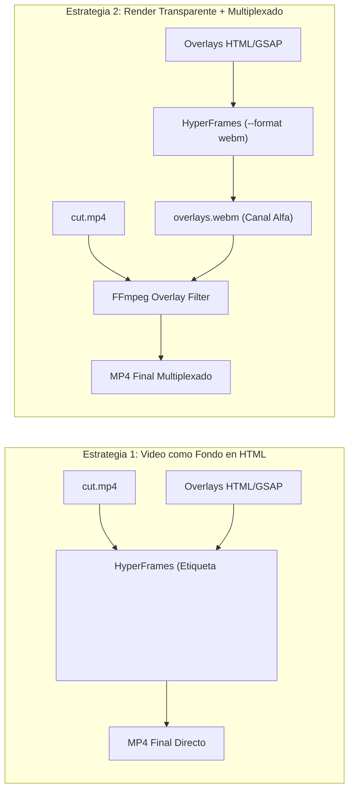

# 04 — Formatos de Video Soportados

Este documento define la especificacion de diseño y los contratos de implementacion para los dos formatos de video que produce el pipeline.

---

## 1. Formato 1: Grabacion a Camara y Pantalla (Talking Head)

* **Proposito:** Videos donde el autor expone un tema en camara o comparte su escritorio, enriquecido con elementos graficos dinamicos sincronizados con el habla.
* **Componentes Visuales:**
  1. **Subtitulos Cineticos:** Palabras individuales que aparecen o cambian de color en el milisegundo exacto de su pronunciacion (estilo tipografia cinetica).
  2. **Tarjetas Flotantes (*Lower-Thirds*):** Paneles informativos con definiciones, comandos de consola o advertencias tecnicas.
  3. **Llamadas de Atencion:** Recuadros, flechas o efectos de zoom focalizados sobre elementos de la grabacion de pantalla.

### 1.1. Arquitectura de Composicion de Capas

Existen dos estrategias tecnicas para ensamblar este formato:

* **Estrategia Recomendada:** La *Estrategia 1* (incrustar el video crudo recortado directamente en la composicion de HyperFrames mediante `<video src="cut.mp4">`) permite al motor de Chrome sincronizar el fotograma exacto del video con las animaciones de texto sin requerir pasadas adicionales de multiplexado en FFmpeg.

---

## 2. Formato 2: Explicador Tecnico Abstracto (Sin Rostro)

* **Proposito:** Videos de alta densidad tecnica donde la voz en off guia la visualizacion de conceptos de software, flujos de paquetes en redes, arquitectura de microservicios o estructuras de datos.
* **Motor Grafico Principal:** HyperFrames con SVG y Prism.js.

### 2.1. Modelado de Diagramas de Arquitectura con SVG
El agente genera codigo SVG donde los elementos de infraestructura se representan como nodos y aristas:
* **Nodos:** Rectangulos con bordes redondeados y texto tipografico que representan servidores, microservicios, bases de datos o clientes.
* **Conexiones:** Lineas vectoriales con `stroke-dasharray` y `stroke-dashoffset` animados con GSAP para simular flujo continuo de datos o paquetes de red.
* **Resaltado de Codigo:** Bloques `<pre><code>` estilizados con temas de alto contraste (ej. Dracula o OneDark), donde GSAP activa el resaltado de lineas especificas al momento en que la voz las explica.

### 2.2. Opcion Matematica con Manim (Python)
Cuando el video requiere precision geometrica absoluta, graficos continuos o calculo de algoritmos (matrices, arboles binarios balanceados o grafos pesados):
* Se puede incorporar **Manim Community Edition** dentro de la carpeta `templates/tech_explainer/` para generar fragmentos de video especificos que posteriormente se integran como clips de apoyo.

---

## 3. Matriz de Seleccion de Motor

| Caracteristica | Formato 1 (Talking Head) | Formato 2 (Arquitectura/Redes) | Formato 2 (Matematicas/Calculo) |
| :--- | :--- | :--- | :--- |
| **Pista Visual Base** | Grabacion de camara o pantalla | Vacia (generada por codigo) | Vacia (generada por codigo) |
| **Motor Recomendado** | HyperFrames (HTML + GSAP) | HyperFrames (HTML + SVG + GSAP) | Manim (Python / Cairo) |
| **Tiempo de Render** | 0.6x - 1.0x tiempo real | 0.3x - 0.7x tiempo real | 1.5x - 3.0x tiempo real |
| **Manejo de Subtitulos** | Nativo mediante timestamps | Opcional | Raramente utilizado |

---

## 4. Enlaces Relacionados

* Consultar los runbooks paso a paso en [05-guia-operativa-y-flujos.md](./05-guia-operativa-y-flujos.md).
* Volver al indice general en [00-indice-general.md](./00-indice-general.md).
