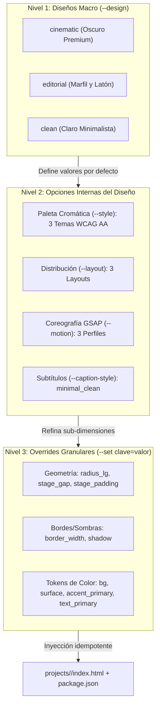

# Sistema de Diseño y Estilos Componibles en 3 Niveles

Este documento especifica la arquitectura del motor de sistemas de diseño y temas visuales implementado en [`core/styles.py`](../../core/styles.py). El motor permite alternar de manera no destructiva entre diseños estructuralmente distintos, configurar opciones internas de cada diseño y aplicar ajustes granulares por proyecto sin alterar el contenido HTML, los activos multimedia ni las marcas de tiempo de transcripción.

---

## 1. Arquitectura Jerárquica de 3 Niveles

El sistema desacopla la presentación visual del contenido semántico mediante tres niveles de composición ortogonales:



### Principios de Ingeniería del Motor
1. **Conmutación No Destructiva:** Los bloques CSS y atributos de datos se inyectan dentro de delimitadores explícitos (`/* @theme:start */`, `/* @design-system:start */`, `/* @caption-style:start */`). El árbol DOM del usuario, los textos y las etiquetas `<video>` permanecen intactos.
2. **Persistencia Declarativa (`videoDesign`):** La configuración activa de los 3 niveles se almacena en el archivo `package.json` del proyecto. Esto permite modificar una sola dimensión en el futuro (por ejemplo, cambiar únicamente `--layout` o `--set`) conservando el Diseño Macro y las demás opciones elegidas previamente.
3. **Cumplimiento Estricto WCAG AA:** Todos los temas oscuros y claros calibran sus colores de texto primario, secundario, atenuado (`--text-muted`) y acentos para garantizar un ratio de contraste mínimo de `4.5:1` en texto normal y `3.0:1` en texto grande, verificable con `pnpm exec hyperframes check`.

---

## 2. Nivel 1: Catálogo de Diseños Macro (`--design` / `-d`)

| Identificador (`-d`) | Nombre Técnico | Geometría y Superficie | Tema Nativo | Motion / Captions Nativo | Caso de Uso Principal |
| :--- | :--- | :--- | :--- | :--- | :--- |
| `cinematic` *(Defecto)* | Cinematic (Oscuro Premium) | Curvas amplias (`28px`), desenfoque suave (`blur(24px)`), sombra ambiental y bordes simétricos limpios. | `dark_violet` | `smooth` / `minimal_clean` | Videos verticales TikTok/Reels, tecnología, reflexiones de alto impacto y presentador. |
| `editorial` | Editorial (Marfil y Latón) | Estética cálida y serena con fondo marfil, esquinas orgánicas (`20px`), borde fino (`1px`), desenfoque suave (`blur(16px)`), sombra difusa, titulares estilizados de ancho contenido (`56px`/`54px`, `700`, `text-transform: none`, `max-width: 780px`/`1020px`) y lienzo superior despejado (`#progress-bar` y `#brand-bar` ocultos). | `paper_warm` | `minimal` / `minimal_clean` | Versículos bíblicos, citas, historia, filosofía y ensayos reflexivos. |
| `clean` | Clean (Claro Minimalista) | Canvas blanco neutro con tarjetas elevadas (`24px`), sombras suaves multicapa y bordes sutiles. | `clean_light` | `smooth` / `minimal_clean` | Explicaciones corporativas, tutoriales claros y presentaciones limpias. |

---

## 3. Nivel 2: Opciones Internas dentro de un Diseño

### 3.1. Temas Cromáticos (`--style` / `-s`)

| Identificador (`-s`) | Nombre | Fondo Principal (`--bg`) | Acento Primario (`--accent-primary`) | Acento Secundario (`--accent-secondary`) | Naturaleza Cromática |
| :--- | :--- | :--- | :--- | :--- | :--- |
| `dark_violet` *(Defecto)* | Dark Violet (Obsidiana y Cristal) | `#06060a` | `#a78bfa` (Violeta) | `#34d399` (Esmeralda) | Oscuro atmosférico de alto contraste |
| `paper_warm` | Paper Warm (Marfil, Arena y Latón) | `#f5f1ea` | `#875c22` (Latón Dorado) | `#8c2d19` (Carmesí Terracota) | Claro cálido sereno de alta legibilidad |
| `clean_light` | Clean Light (Blanco Neutro) | `#f8fafc` | `#0369a1` (Azul) | `#047857` (Verde) | Claro limpio calibrado WCAG AA |

### 3.2. Variantes de Distribución (`--layout`)

| Identificador (`--layout`) | Descripción Estructural |
| :--- | :--- |
| `standard` *(Defecto)* | Distribución equilibrada: columnas simétricas `1fr 1fr` en `split-stage`, tarjeta lower-third alineada a la izquierda (`left: 80px`). |
| `asymmetric_focus` | Foco asimétrico: columna principal `1.35fr` y secundaria `0.85fr`; tarjeta lower-third alineada a la derecha (`right: 80px`). |
| `stacked` | Disposición vertical apilada (`grid-template-columns: 1fr`) y cabecera centrada. |

### 3.3. Perfiles de Coreografía GSAP (`--motion`)

| Identificador (`--motion`) | Curva de Entrada (`ease`) | Duración Base | Comportamiento Visual |
| :--- | :--- | :--- | :--- |
| `smooth` *(Defecto)* | `power2.out` / `power3.out` | `0.95s` | Desaceleración progresiva y fluida de estilo editorial/cinematográfico. |
| `snappy` | `power4.out` / `back.out(2.0)` | `0.45s` | Transición rápida y enérgica ideal para Shorts y Reels. |
| `minimal` | `power1.out` | `0.35s` | Aparición sobria y discreta para lectura tranquila. |

### 3.4. Estilos de Subtítulos Cinéticos (`--caption-style`)

| Identificador (`--caption-style`) | Efecto sobre la Palabra Activa (`.word.active`) | Opacidad Inactiva |
| :--- | :--- | :--- |
| `minimal_clean` *(Estándar Único)* | Lectura limpia sobria sin cajas ni cápsulas; bloques de 1 a 2 líneas balanceadas (`text-wrap: balance`, `max-width: 780px` en 9:16 y `1180px` en 16:9) sin solapamiento temporal entre frases; resalta mediante opacidad `1.0`, color de acento (`--accent-secondary` en `.word-emphasis`) y `var(--caption-shadow)`. | `0.40` |

---

## 4. Nivel 3: Overrides Granulares por Proyecto (`--set clave=valor`)

El Nivel 3 permite ajustar tokens geométricos o cromáticos específicos en un único proyecto sin modificar el catálogo global ni perder la capacidad de cambiar de Diseño Macro posteriormente.

| Categoría | Propiedad (`--set`) | Variable CSS / Efecto Destino | Ejemplo de Uso |
| :--- | :--- | :--- | :--- |
| **Geometría** | `radius_lg`, `radius_md`, `radius_sm`, `border_width` | `--radius-lg`, `--radius-md`, `--radius-sm`, `--border-width` | `--set radius_lg=0px` |
| **Espaciado / Layout** | `stage_padding`, `stage_gap`, `split_columns`, `header_align`, `lower_third_side` | `--stage-padding`, `--stage-gap`, `--split-columns`, posición lower-third | `--set stage_gap=56px` |
| **Subtítulos** | `caption_bottom`, `caption_size`, `caption_bg`, `caption_text`, `caption_active` | Variables de subtítulos en `:root` | `--set caption_size=48px` |
| **Tipografía y Color** | `font_display`, `font_sans`, `font_mono`, `bg`, `bg_gradient`, `surface`, `accent_primary`, `accent_primary_glow`, `panel_highlight`, `headline_shadow`, `text_primary`, etc. | Tokens semánticos en `:root` (sobrescribir `accent_primary` o `accent_secondary` recalcula automáticamente `-soft`, `-glow` y `--title-gradient` vía `color-mix()`) | `--set accent_primary=#f43f5e` |

---

## 5. Ejemplos Prácticos de Composición y Conmutación

```bash
# Consultar el catálogo completo o en JSON
uv run python core/pipeline.py style --list
uv run python core/pipeline.py style --list --json

# Cambiar a Diseño Macro editorial (cálido pergamino) o clean (blanco neutro)
uv run python core/pipeline.py style mi-proyecto -d editorial
uv run python core/pipeline.py style mi-proyecto -d clean

# Combinar diseño editorial con paleta limpia y foco asimétrico
uv run python core/pipeline.py style mi-proyecto -d editorial -s clean_light --layout asymmetric_focus

# Ajustar un token puntual e inspeccionar estado
uv run python core/pipeline.py style mi-proyecto --set accent_primary=#ff5500 --set stage_gap=60px
uv run python core/pipeline.py style mi-proyecto --inspect
uv run python core/pipeline.py style mi-proyecto --reset-overrides
```

---

## 6. Enlaces Relacionados

* Ver el catálogo de las 7 plantillas esenciales en [02-formatos-de-video.md](../03-renderizado-y-formatos/02-formatos-de-video.md).
* Consultar los flujos de trabajo paso a paso en [01-guia-operativa-y-flujos.md](../05-operacion-y-flujos/01-guia-operativa-y-flujos.md).
* Volver al índice maestro en [00-indice-general.md](../00-indice-general.md).
