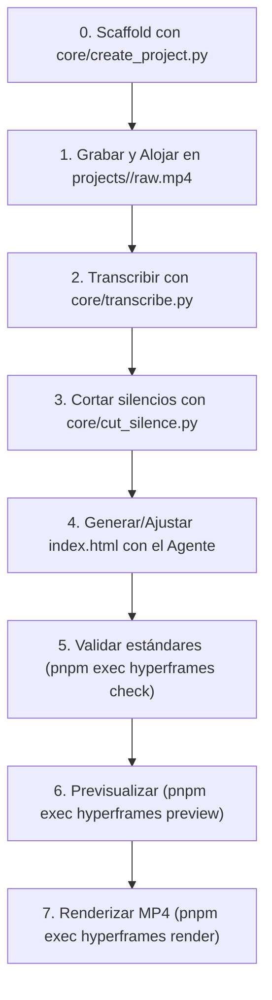

# 05 — Guía Operativa y Flujos de Trabajo (Runbooks)

Este documento describe los procedimientos operativos paso a paso para ejecutar el pipeline de produccion de video desde la captura en crudo hasta la exportacion final del archivo MP4.

---

## 1. Runbook: Produccion Completa de un Video

El flujo estandar consta de cinco etapas consecutivas:



---

### Paso 1: Inicializar el Proyecto mediante Scaffolding
Utiliza el CLI automatizado para crear la estructura base a partir de cualquiera de las 5 plantillas optimizadas:

```bash
cd video-pipeline

# Crear proyecto vertical 9:16 para redes sociales (Shorts/Reels/TikTok)
python3 core/create_project.py mi-video --template portrait_9_16 --title "Título de Alto Impacto"

# Si es un video con presentador o explicador de código:
# python3 core/create_project.py mi-video --template talking_head
# python3 core/create_project.py mi-video --template tech_explainer
```

Si cuentas con una grabacion de audio o camara en crudo, copiala al directorio del proyecto:
```bash
cp /ruta/a/mi_grabacion.mp4 projects/mi-video/raw.mp4
```

---

### Paso 2: Generar Marcas de Tiempo con Whisper
Ejecuta el script de transcripcion local utilizando el entorno virtual gestionado por `uv`:

```bash
.venv/bin/python core/transcribe.py \
  -i projects/mi-video/raw.mp4 \
  -o projects/mi-video/transcript.json \
  -m base \
  -l es
```

> [!NOTE]
> Para audios con terminologia tecnica densa en ingles o nombres de librerias de software, puedes emplear el modelo `-m small` o `-m medium` para incrementar la precision de reconocimiento.

---

### Paso 3: Recortar Silencios Automáticamente
Ejecuta el filtro algoritmico de FFmpeg para podar pausas muertas:

```bash
core/cut_silence.py \
  -i projects/mi-video/raw.mp4 \
  -o projects/mi-video/cut.mp4 \
  --noise-db -30.0 \
  --min-silence 0.45
```

---

### Paso 4: Generacion Asistida de la Escena
Con el archivo `transcript.json` generado, solicita al agente la creacion de la composicion web:
* **Prompt para el agente:** *"Lee `projects/mi-video/transcript.json`. Es un video de tipo [Talking Head / Diagrama de Arquitectura]. Genera `projects/mi-video/index.html` con [subtitulos cineticos en palabras clave / cajas de servidores animadas] sincronizadas con los segundos de la transcripcion."*

---

### Paso 5: Validar Estándares de Accesibilidad y Render
Antes de compilar, verifica que la escena cumpla con las reglas WCAG AA, layout y tiempos deterministas:

```bash
pnpm exec hyperframes check projects/mi-video
```

---

### Paso 6: Previsualizacion Interactiva (Opcional)
Si deseas inspeccionar la linea de tiempo en el navegador:

```bash
pnpm exec hyperframes preview projects/mi-video
```
Esto abrira el estudio visual interactivo en `http://localhost:3002`.

---

### Paso 7: Compilacion Final a MP4
Ejecuta el renderizador con aceleracion de hardware (GPU AMD/Mesa):

```bash
pnpm exec hyperframes render projects/mi-video -o projects/mi-video/final.mp4
```

El video final quedara disponible en `projects/mi-video/final.mp4`.

---

## 2. Diagnostico y Resolucion de Incidencias

### 2.1. Verificacion de Salud del Entorno
Si el renderizador experimenta problemas o no detecta la GPU:
```bash
cd video-pipeline
pnpm exec hyperframes doctor
```
El reporte debe marcar en verde `FFmpeg`, `FFprobe`, `Node.js` y `Chrome (cache)`.

### 2.2. Error de Desajuste de Modulo en Python
Si se produce un error de importacion al invocar `transcribe.py`:
```bash
uv pip install --python .venv/bin/python -r requirements.txt
```

### 2.3. Espacio Insuficiente en `/tmp`
HyperFrames utiliza `/tmp` para cachear fotogramas intermedios. Si un video largo (> 10 minutos) llena la particion:
```bash
pnpm exec hyperframes clean
```

---

## 3. Enlaces Relacionados

* Volver al indice general de la documentacion en [00-indice-general.md](./00-indice-general.md).
* Consultar la guia rapida en el [README.md de la raiz](../README.md).
