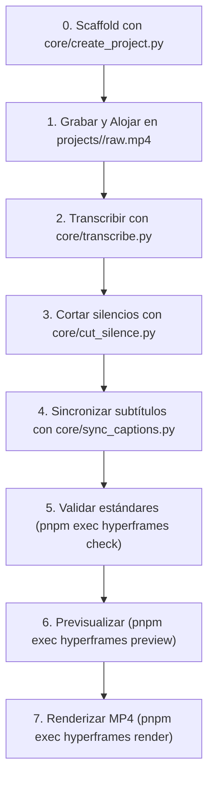

# 05 — Guía Operativa y Flujos de Trabajo (Runbooks)

Este documento describe los procedimientos operativos paso a paso para ejecutar el pipeline de produccion de video desde la captura en crudo hasta la exportacion final del archivo MP4.

---

## 1. Flujo Automatizado de Producción (Golden Path)

El orquestador unificado permite convertir un archivo crudo en un video final listo para publicación con un solo comando:

```bash
cd video-pipeline

uv run python core/pipeline.py produce \
  -i /ruta/a/grabacion_cruda.mp4 \
  -p tutorial-kubernetes \
  -t talking_head_16_9 \
  -d cinematic \
  -s dark_violet \
  --layout standard \
  --caption-style minimal_clean \
  --title "Arquitectura Kubernetes en 60s" \
  --auto-render
```

> [!TIP]
> Puedes elegir cualquiera de los **3 Diseños Macro** (`-d cinematic`, `-d editorial`, `-d clean`), cualquiera de las **3 paletas cromáticas** (`-s`) y cualquiera de las **7 plantillas esenciales** (`-t`), o conmutar el diseño completo de un proyecto ya producido sin perder datos ni repetir la transcripción ejecutando:
> `uv run python core/pipeline.py style tutorial-kubernetes -d editorial --layout asymmetric_focus --caption-style minimal_clean`

Este comando ejecuta automáticamente:
1. Scaffolding del proyecto desde la plantilla especificada.
2. Recorte algorítmico de pausas muertas con FFmpeg (`cut.mp4`).
3. Transcripción y marcas de tiempo palabra por palabra con Whisper (`transcript.json`).
4. Generación e inyección de subtítulos cinéticos en HTML/GSAP y exportación de archivos `.srt` y `.vtt`.
5. Auditoría de accesibilidad WCAG AA con `hyperframes check`.
6. Renderizado final acelerado por GPU (`video_tutorial-kubernetes.mp4`).

---

## 2. Flujo Modular Paso a Paso

Si se requiere intervenir en etapas intermedias o afinar animaciones de manera personalizada:



---

### Paso 1: Inicializar el Proyecto mediante Scaffolding
Utiliza el CLI automatizado para crear la estructura base a partir de cualquiera de las **7 plantillas esenciales** y los **3 Diseños Macro**:

```bash
cd video-pipeline

# 1. Video vertical 9:16 para citas, versículos y reflexiones (sin código)
uv run python core/create_project.py salmo-23 -t short_quote_9_16 -d editorial --title "Salmo 23"

# 2. Video vertical 9:16 para tips técnicos y código
uv run python core/create_project.py tip-docker -t short_tech_9_16 -d cinematic --title "Docker en 60s"

# 3. Presentador vertical 9:16 o horizontal 16:9 con subtítulos cinéticos
uv run python core/create_project.py reel-presentador -t talking_head_9_16 -d cinematic
uv run python core/create_project.py youtube-presentador -t talking_head_16_9 -d clean

# 4. Narrativa widescreen 16:9 para historia, ensayos o divulgación
uv run python core/create_project.py historia-roma -t editorial_16_9 -d editorial
```

Si cuentas con una grabacion de audio o camara en crudo, copiala al directorio del proyecto:
```bash
cp /ruta/a/mi_grabacion.mp4 projects/mi-video/raw.mp4
```

---

### Paso 2: Generar Marcas de Tiempo con Whisper
Ejecuta el script de transcripcion local utilizando el entorno virtual gestionado por `uv`:

```bash
.venv/bin/python core/transcribe.py \
  -i projects/mi-video/raw.mp4 \
  -o projects/mi-video/transcript.json \
  -m base \
  -l es
```

> [!NOTE]
> Para audios con terminologia tecnica densa en ingles o nombres de librerias de software, puedes emplear el modelo `-m small` o `-m medium` para incrementar la precision de reconocimiento.

---

### Paso 3: Recortar Silencios Automáticamente
Ejecuta el filtro algoritmico de FFmpeg para podar pausas muertas:

```bash
uv run python core/cut_silence.py \
  -i projects/mi-video/raw.mp4 \
  -o projects/mi-video/cut.mp4 \
  --noise-db -30.0 \
  --min-silence 0.45
```

---

### Paso 4: Generacion Asistida de la Escena
Con el archivo `transcript.json` generado, solicita al agente la creacion de la composicion web:
* **Prompt para el agente:** *"Lee `projects/mi-video/transcript.json`. Es un video de tipo [Talking Head / Diagrama de Arquitectura]. Genera `projects/mi-video/index.html` con [subtitulos cineticos en palabras clave / cajas de servidores animadas] sincronizadas con los segundos de la transcripcion."*

---

### Paso 5: Validar Estándares de Accesibilidad y Render
Antes de compilar, verifica que la escena cumpla con las reglas WCAG AA, layout y tiempos deterministas:

```bash
pnpm exec hyperframes check projects/mi-video
```

---

### Paso 6: Previsualizacion Interactiva (Opcional)
Si deseas inspeccionar la linea de tiempo en el navegador:

```bash
pnpm exec hyperframes preview projects/mi-video
```
Esto abrira el estudio visual interactivo en `http://localhost:3002`.

---

### Paso 7: Compilacion Final a MP4
Ejecuta el renderizador con aceleracion de hardware (GPU AMD/Mesa):

```bash
pnpm exec hyperframes render projects/mi-video -o projects/mi-video/video_mi-video.mp4
```

El video final quedara disponible en `projects/mi-video/video_mi-video.mp4`.

---

## 3. Flujo Faceless Multi-Escena (`storyboard.json` y `--auto-storyboard`)

Para producir videos explicativos sin presentador a cámara en `9:16` (`explainer_scenes_9_16`) o `16:9` (`explainer_scenes_16_9`), existen dos vías operativas:

### 3.1. Generación Automática desde Voz (`--auto-storyboard`)
```bash
uv run python core/pipeline.py produce \
  -i mi_voz.wav \
  -p mi-explainer \
  -t explainer_scenes_9_16 \
  -d editorial \
  -s paper_warm \
  --auto-storyboard \
  --auto-render
```

### 3.2. Guion Visual Declarativo (`--storyboard`, `cue_word`, `hero_top` y `custom_scene`)
Permite definir cada escena con su componente narrativo, transición (`snap`, `zoom_in`, `slide_up`), atmósfera por escena (`sunburst`, `grid`, `clean`), color de acento (`primary`, `danger`, `secondary`, `warning`, `tertiary` o color hex), SFX primario + sub-eventos, cama ambiental con *ducking* (`--ambient-bed` o `--music`), corrección de términos en Whisper (`--replace`) y palabra clave de sincronización (`cue_word`):

```bash
uv run python core/pipeline.py produce \
  -i mi_voz.wav \
  -p mi-explainer \
  -t explainer_scenes_9_16 \
  -d cinematic \
  -s dark_violet \
  --storyboard guion.json \
  --replace lidis=Redis \
  --ambient-bed \
  --voice-polish \
  --auto-render
```

Para recompilar únicamente el storyboard y mezclar SFX + cama con *ducking* y limpieza vocal tras editar `storyboard.json`:
```bash
uv run python core/pipeline.py storyboard mi-explainer --mix-sfx --audio projects/mi-explainer/cut.wav --ambient-bed --voice-polish
```

### 3.3. Catálogo de los 29 Componentes Narrativos (`COMPONENT_REGISTRY`)

| Componente | Uso Principal | Propiedades Clave (`props`) |
| :--- | :--- | :--- |
| `timeline_steps` | Procesos, historia, secuencias paso a paso | `steps: [{tag, title, detail, highlight}]` |
| `comparison_split` | Comparativas Antes/Después, A vs B | `left: {title, items}`, `right: {title, items, highlight}` |
| `quote_focus` | Citas, versículos, leyes o tesis centrales | `quote`, `author`, `context` |
| `bar_chart` | Métricas proporcionales, porcentajes, rankings | `bars: [{label, value, display, highlight}]` |
| `code_spotlight` | Bloques de código o CLI con línea resaltada | `language`, `lines`, `highlight_line` |
| `icon_spotlight` | Icono SVG de `assets/icons/` (o `coleccion:nombre` desde Iconify) + anillo radial | `icon`, `label`, `sublabel`, `ring_progress` |
| `stat_callout` | Dato único de alto impacto + barras opcionales | `value` (o `primary_text`), `label` (o `secondary_text`), `note`, `bars` |
| `phone_mockup` | Smartphone en modo lista (`list`) o pantalla de apps (`app_grid`) con anillo HUD, flash y cursor | `mode` (`list` \| `app_grid`), `app_title`, `items`, `clock_start`, `clock_end`, `alert_text`, `capture_flash`, `capture_count`, `show_cursor` |
| `network_graph` | Topología de nodos y trazado de rutas | `nodes: [{id, label, x, y, alert}]`, `edges`, `center_label` |
| `terminal_grid` | Matriz de 6 terminales con LEDs y vibración de alerta | `screens: [{id, lines, status}]` |
| `connector_flow` | Conexión física o lógica entre puerto host y dispositivo | `left_label`, `right_label`, `status_text` |
| `radar_map` | Mapa vectorial (`assets/maps/<preset>.svg`), ruta animada y radar táctico 360° | `region`, `map_preset` (`korea` \| `world` \| `europe` \| `americas` \| `asia`), `route`, `targets: [{label, sublabel, x, y, alert}]` |
| `xray_scanner` | Marco HUD con barrido láser horizontal y tarjetas laterales | `subject`, `footer_tag`, `callouts: [{title, detail, side}]` |
| `system_alert` | Modal de advertencia del sistema con efecto máquina de escribir (`typewriter`) | `title`, `message`, `subtext` |
| `hex_inspector` | Volcado hexadecimal de memoria con fila activa y hallazgo | `target_addr`, `tag`, `finding` |
| `desktop_monitor` | Monitor panorámico de sistema operativo con barra de tareas e iconos | `os_name`, `subtitle` |
| `keyboard_type` | Teclado QWERTY interactivo con teclas activas, caja de texto y sugerencias | `typed_text`, `active_keys`, `suggestions` |
| `padlock_denied` | Candado vectorial encadenado con sello de bloqueo (`ACCESO DENEGADO`) | `stamp`, `detail` |
| `file_cards` | Tarjetas de archivos marcados con número de serie / huella criptográfica | `serial_code`, `files`, `caption` |
| `toggle_alert` | Panel de sistema con switch interactivo, alerta de integridad y apagón CRT determinista | `label`, `state_on`, `state_off`, `alert_title`, `alert_detail`, `crt_reboot` |
| `conveyor_factory` | Línea de producción industrial con prensa estampadora y dispositivos en cinta | `caption`, `device_tag` |
| `cta_card` | Cierre interactivo con llamada a la acción y mutación de candado seguro a ojo/alerta | `cta_text`, `clock`, `before_label`, `after_label` |
| `canvas_fx` | Primitiva Canvas 2D 100% determinista conducida por proxy en GSAP (`onUpdate`) | `effect` (`particles` \| `matrix` \| `radar_waves` \| `noise_field`), `title`, `subtitle`, `color` |
| `image_cutout` | Recorte transparente o imagen procesada (`assets/images/`) con entrada elástica y flotación | `src`, `title`, `subtitle`, `max_width`, `float_motion` |
| `infinite_canvas` | Cámara virtual 2D sobre lienzo continuo con nodos conectados por curvas Bezier y zoom-out panorámico | `world_width`, `world_height`, `zoom_out_end`, `show_connectors`, `writing_head`, `nodes: [{tag, title, detail, items, x, y, scale, at, highlight}]` |
| `svg_draw` | Trazos SVG progresivos sincronizados con timestamps (`stroke-dashoffset` + `MotionPathPlugin`) | `view_box`, `title`, `subtitle`, `writing_head`, `paths: [{d, color, stroke_width, dashed, at, duration, label}]`, `labels`, `strike_through` |
| `scene_3d` | Motor WebGL 3D determinista sobre Three.js (`onUpdate`, sin `requestAnimationFrame`) con primitivos procedurales y `.glb`/`.gltf` | `preset` (`cross` \| `altar` \| `scales` \| `gavel` \| `bars` \| `columns` \| `cube` \| `torus` \| `sphere`), `model` (`assets/models/*.glb`: `shield_3d.glb`, `gear_3d.glb`, `crown_3d.glb`, `open_book_3d.glb`, `lock_3d.glb`, `globe_3d.glb`, etc.), `render_style` (`edges` \| `wireframe` \| `solid`), `dot_grid`, `camera_orbit`, `camera_distance`, `rotation_turns`, `color`, `title` |
| `video_clip` | Clip de video real (presentador a cámara `cut.mp4`, screencast o B-roll en `assets/videos/`) dentro de un storyboard híbrido | `src` (`cut.mp4` o `assets/videos/*.mp4`), `layout_mode` (`card` \| `full` \| `pip`), `tag`, `title`, `subtitle`, `items`, `muted` |
| `custom_scene` | Escena abierta para inyectar cualquier composición SVG/HTML y coreografía GSAP a medida | `html` (con marcador `{scene_id}`), `gsap` (con `{scene_id}` y `{start}`) |

### 3.4. Ejemplo de Escena 3D Determinista con Modelo de Blender (`scene_3d`)
Tras exportar un modelo desde Blender en formato `.glb` e importarlo con `uv run python core/pipeline.py assets model cordero --file ./cordero.glb`, se referencia directamente en `storyboard.json`:

```json
{
  "id": "sc_cordero_3d",
  "start": 12.0,
  "end": 18.0,
  "cue_word": "cordero",
  "badge": "02 · Sustitución",
  "headline": "El Cordero de Dios",
  "component": "scene_3d",
  "transition": "zoom_in",
  "sfx": "sub_hit",
  "props": {
    "model": "cordero.glb",
    "render_style": "edges",
    "dot_grid": true,
    "camera_orbit": true,
    "rotation_turns": 0.4
  }
}
```

### 3.5. Ejemplo de Escena a Medida con `custom_scene`
Cuando una frase del guion requiere una metáfora visual única (por ejemplo, una lupa inspeccionando paquetes, una fábrica en serie o un diagrama bespoke), se define directamente en `storyboard.json` usando `custom_scene`:

```json
{
  "id": "sc_bespoke",
  "start": 4.0,
  "end": 7.5,
  "cue_word": "auditoría",
  "headline": "",
  "component": "custom_scene",
  "transition": "zoom_in",
  "sfx": "scan",
  "accent": "secondary",
  "atmosphere": "grid",
  "props": {
    "html": "<svg width='760' height='520' viewBox='0 0 760 520'><circle id='{scene_id}_lens' cx='380' cy='260' r='140' fill='none' stroke='var(--accent-secondary)' stroke-width='6'/></svg>",
    "gsap": "tl.fromTo('#{scene_id}_lens', { scale: 0.7, opacity: 0, svgOrigin: '380 260' }, { scale: 1, opacity: 1, duration: 0.45, ease: 'back.out(1.8)' }, {start});"
  }
}
```

---

## 4. Diagnostico y Resolucion de Incidencias

### 2.1. Verificacion de Salud del Entorno
Si el renderizador experimenta problemas o no detecta la GPU:
```bash
cd video-pipeline
pnpm exec hyperframes doctor
```
El reporte debe marcar en verde `FFmpeg`, `FFprobe`, `Node.js` y `Chrome (cache)`.

### 3.2. Error de Desajuste de Modulo en Python
Si se produce un error de importacion al invocar `transcribe.py`:
```bash
uv pip install --python .venv/bin/python -e ".[dev]"
```

### 2.3. Espacio Insuficiente en `/tmp`
HyperFrames utiliza `/tmp` para cachear fotogramas intermedios. Si un video largo (> 10 minutos) llena la particion:
```bash
pnpm exec hyperframes clean
```

---

## 4. Enlaces Relacionados

* Volver al indice general de la documentacion en [00-indice-general.md](../00-indice-general.md).
* Consultar la guia rapida en el [README.md de la raiz](../../README.md).
