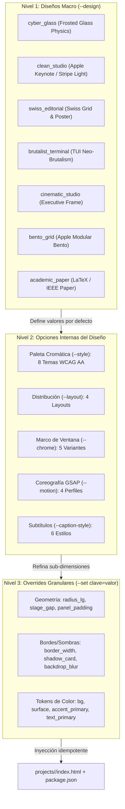

# 06 — Sistema de Diseño y Estilos Componibles en 3 Niveles

Este documento especifica la arquitectura del motor de sistemas de diseño y temas visuales implementado en [`core/styles.py`](../core/styles.py). El motor permite alternar de manera no destructiva entre diseños estructuralmente distintos, configurar opciones internas de cada diseño y aplicar ajustes granulares por proyecto sin alterar el contenido HTML, los activos multimedia ni las marcas de tiempo de transcripción.

---

## 1. Arquitectura Jerárquica de 3 Niveles

El sistema desacopla la presentación visual del contenido semántico mediante tres niveles de composición ortogonales:



### Principios de Ingeniería del Motor
1. **Conmutación No Destructiva:** Los bloques CSS y atributos de datos se inyectan dentro de delimitadores explícitos (`/* @theme:start */`, `/* @design-system:start */`, `/* @caption-style:start */`). El árbol DOM del usuario, los textos y las etiquetas `<video>` permanecen intactos.
2. **Persistencia Declarativa (`videoDesign`):** La configuración activa de los 3 niveles se almacena en el archivo `package.json` del proyecto. Esto permite modificar una sola dimensión en el futuro (por ejemplo, cambiar únicamente `--layout` o `--set`) conservando el Diseño Macro y las demás opciones elegidas previamente.
3. **Cumplimiento Estricto WCAG AA:** Todos los temas oscuros y claros calibran sus colores de texto primario, secundario, atenuado (`--text-muted`) y acentos para garantizar un ratio de contraste mínimo de `4.5:1` en texto normal y `3.0:1` en texto grande, verificable con `pnpm exec hyperframes check`.

---

## 2. Nivel 1: Catálogo de Diseños Macro (`--design` / `-d`)

Un **Diseño Macro** ([`DesignSystem`](../core/styles.py)) transforma la estructura visual completa del video: geometría de esquinas, grosor de bordes, sombras proyectadas, presencia o ausencia de barras de ventana, tipografía base, tema cromático predeterminado y curvas de animación GSAP.

| Identificador (`-d`) | Nombre Técnico | Geometría y Superficie | Tema Nativo | Layout / Chrome / Motion Nativo | Caso de Uso Principal |
| :--- | :--- | :--- | :--- | :--- | :--- |
| `cyber_glass` *(Defecto)* | Cyber Glass & Frosted Glass | Paneles translúcidos con bisel superior/izquierdo especular, desenfoque profundo saturado (`blur(32px) saturate(190%)`), controles macOS y orbes ambientales. | `cyber_dark` | `standard` / `macos_dots` / `dynamic` | Tutoriales de desarrollo, ingeniería cloud, demos de producto de impacto visual. |
| `clean_studio` | Clean Studio (Apple / Stripe) | Canvas blanco puro con orbes cálidos difusos, tarjetas blancas puras con bisel translúcido, sombras multicapa suaves y chips de métricas KPI. | `minimal_light` | `standard` / `hidden` / `smooth` | Lanzamientos de producto, keynotes corporativas, presentaciones de arquitectura de alto nivel. |
| `swiss_editorial` | Swiss Editorial Grid | Retícula editorial suiza con esquinas casi rectas (`2px`), filete superior grueso (`4px solid`) y cero desenfoque. | `minimal_light` | `standard` / `minimal_line` / `smooth` | Presentaciones ejecutivas, arquitectura empresarial y divulgación técnica limpia. |
| `brutalist_terminal` | Brutalist Terminal HUD | Esquinas a 90 grados (`0px`), bordes sólidos de `2px` en color de acento y sombra dura desplazada (`8px 8px 0px`). | `terminal_hacker` | `standard` / `terminal_bar` / `snappy` | Ciberseguridad, administración de sistemas Linux, DevOps, redes y CLI. |
| `cinematic_studio` | Cinematic Studio Frame | Curvas amplias (`28px`), sombra ambiental cinematográfica, franja lateral de acento (`6px solid`) sin barra superior. | `linear_violet` | `standard` / `hidden` / `smooth` | Keynotes, lanzamientos de software, videos de presentador y narrativa técnica. |
| `bento_grid` | Bento Grid Modular | Tarjetas modulares estilo Bento con radios suaves (`24px`), borde interno iluminado y cabeceras limpias. | `dracula_pro` | `standard` / `minimal_line` / `dynamic` | Resúmenes de funcionalidades, comparativas de métricas y microlearning en feeds. |
| `academic_paper` | Academic Paper & IEEE | Estética de publicación científica con filetes superiores/inferiores (`3px`/`1px solid`), esquinas sobrias (`4px`) y alto contraste. | `solarized_sand` | `standard` / `hidden` / `minimal` | Explicaciones de algoritmos, estructuras de datos, papers de IA y matemáticas. |

---

## 3. Nivel 2: Opciones Internas dentro de un Diseño

Cuando seleccionas un Diseño Macro en el Nivel 1, este aplica sus opciones nativas. Sin embargo, puedes sobrescribir cualquiera de las 5 dimensiones internas del Nivel 2 sin abandonar el Diseño Macro activo.

### 3.1. Temas Cromáticos (`--style` / `-s`)

Cada [`ThemeTokens`](../core/styles.py) define 18 variables CSS semánticas (`--bg`, `--surface`, `--text-primary`, `--accent-primary`, `--caption-bg`, etc.):

| Identificador (`-s`) | Nombre | Fondo Principal (`--bg`) | Acento Primario (`--accent-primary`) | Acento Secundario (`--accent-secondary`) | Naturaleza Cromática |
| :--- | :--- | :--- | :--- | :--- | :--- |
| `cyber_dark` *(Defecto)* | Cyber Dark (Glass & Neon) | `#070b14` | `#38bdf8` (Cian) | `#10b981` (Esmeralda) | Oscuro profundo de alto contraste |
| `minimal_light` | Minimal Light (Editorial Paper) | `#f8fafc` | `#0369a1` (Azul) | `#047857` (Verde) | Claro limpio calibrado WCAG AA |
| `terminal_hacker` | Terminal Hacker (CRT Phosphor) | `#050805` | `#22c55e` (Verde CRT) | `#eab308` (Ámbar) | Oscuro monocromático de consola |
| `linear_violet` | Linear Violet (Modern SaaS) | `#090714` | `#c084fc` (Violeta) | `#38bdf8` (Cian) | Oscuro atmosférico moderno |
| `blueprint_cad` | Blueprint CAD (Engineering Grid) | `#06152d` | `#64ffda` (Turquesa) | `#38bdf8` (Azul) | Azul técnico de plano de ingeniería |
| `dracula_pro` | Dracula Pro (Vampire IDE) | `#13111c` | `#ff79c6` (Rosa) | `#8be9fd` (Cian) | Oscuro púrpura inspirado en IDE |
| `solarized_sand` | Solarized Sand (Warm Academic) | `#fdf6e3` | `#0369a1` (Azul Cobalto) | `#047857` (Esmeralda) | Claro cálido antirreflejo |
| `crimson_ops` | Crimson Ops (Red Team Security) | `#0c0608` | `#fb7185` (Carmesí) | `#fbbf24` (Ámbar) | Oscuro táctico de operaciones |

### 3.2. Variantes de Distribución (`--layout`)

| Identificador (`--layout`) | Descripción Estructural |
| :--- | :--- |
| `standard` *(Defecto)* | Distribución equilibrada: columnas simétricas `1fr 1fr` en `split-stage`, tarjeta lower-third alineada a la izquierda (`left: 80px`). |
| `asymmetric_focus` | Foco asimétrico: columna principal `1.45fr` y secundaria `0.85fr`; tarjeta lower-third alineada a la derecha (`right: 80px`). |
| `stacked` | Disposición vertical apilada (`grid-template-columns: 1fr`) y cabecera centrada. |
| `compact_hud` | Márgenes perimetrales ampliados y contenedor de subtítulos elevado para dejar mayor aire visual. |

### 3.3. Variantes de Marco de Ventana (`--chrome`)

| Identificador (`--chrome`) | Descripción Visual |
| :--- | :--- |
| `auto` *(Defecto)* | Adopta automáticamente el marco nativo del Diseño Macro seleccionado en el Nivel 1. |
| `macos_dots` | Barra superior con los tres indicadores circulares (rojo, ámbar, verde) y título de archivo. |
| `terminal_bar` | Barra superior de consola TUI con prefijo `[TERM // SYS]`, bordes rectos y fondo de contraste. |
| `minimal_line` | Oculta los botones circulares y deja únicamente una línea divisoria limpia con el título del bloque. |
| `hidden` | Oculta por completo la barra superior (`.win-bar`, `.terminal-bar`) para tarjetas de contenido puro. |

### 3.4. Perfiles de Coreografía GSAP (`--motion`)

| Identificador (`--motion`) | Curva de Entrada (`ease`) | Duración Base | Escala Inicial | Comportamiento Visual |
| :--- | :--- | :--- | :--- | :--- |
| `dynamic` *(Defecto)* | `back.out(1.5)` | `0.8s` | `0.94` | Entrada con rebote elástico sutil y desplazamiento dinámico. |
| `smooth` | `power3.out` | `0.95s` | `0.98` | Desaceleración progresiva y fluida de estilo editorial. |
| `snappy` | `back.out(2.0)` | `0.45s` | `0.92` | Transición rápida y enérgica de respuesta inmediata. |
| `minimal` | `power2.out` | `0.6s` | `1.00` | Aparición sobria sin rebote ni cambio de escala. |

### 3.5. Estilos de Subtítulos Cinéticos (`--caption-style`)

| Identificador (`--caption-style`) | Efecto sobre la Palabra Activa (`.word.active`) | Opacidad Inactiva |
| :--- | :--- | :--- |
| `karaoke_glow` *(Defecto)* | Cambia al color `--accent-primary` con resplandor luminoso (`--caption-glow`) y `scale(1.06)`. | `0.32` |
| `highlight_pill` | Envuelve la palabra pronunciada en una cápsula sólida de color `--accent-primary` con texto contrastado. | `0.45` |
| `pop_scale` | Salto elástico (`scale(1.18) translateY(-4px)`) en color `--accent-secondary`. | `0.30` |
| `minimal_clean` | Lectura editorial sobria sin cambio de escala ni brillo artificial; resalta mediante opacidad `1.0` y color primario. | `0.38` |
| `underline_bar` | Traza una barra inferior sólida de `4px` en color `--accent-primary` debajo de la palabra activa. | `0.35` |
| `box_invert` | Invierte el bloque con fondo `--text-primary`, texto `--bg` y borde de `2px solid var(--accent-primary)`. | `0.40` |

---

## 4. Nivel 3: Overrides Granulares por Proyecto (`--set clave=valor`)

El Nivel 3 permite ajustar tokens geométricos o cromáticos específicos en un único proyecto sin modificar el catálogo global ni perder la capacidad de cambiar de Diseño Macro posteriormente.

### Propiedades Configurables mediante `--set`

| Categoría | Propiedad (`--set`) | Variable CSS / Efecto Destino | Ejemplo de Uso |
| :--- | :--- | :--- | :--- |
| **Geometría** | `radius_lg`, `radius_md`, `radius_sm` | `--radius-lg`, `--radius-md`, `--radius-sm` | `--set radius_lg=0px` |
| **Geometría** | `border_width` | `--border-width` | `--set border_width=3px` |
| **Espaciado / Layout** | `stage_padding`, `stage_gap` | `--stage-padding`, `--stage-gap` | `--set stage_gap=56px` |
| **Espaciado / Layout** | `split_columns`, `header_align`, `lower_third_side` | `--split-columns`, `--header-align`, posición lower-third (`left`/`right`) | `--set lower_third_side=right` |
| **Subtítulos** | `caption_bottom`, `caption_size`, `caption_bg`, `caption_text`, `caption_active` | `--caption-bottom`, `--caption-size`, `--caption-bg`, `--caption-text`, `--caption-active` | `--set caption_size=48px` |
| **Tipografía** | `font_sans`, `font_mono` | `--font-sans`, `--font-mono` | `--set "font_mono='Fira Code', monospace"` |
| **Superficie y Sombra** | `bg`, `surface`, `surface_elevated`, `border`, `border_strong`, `divider`, `shadow` | `--bg`, `--surface`, `--surface-elevated`, `--border`, `--border-strong`, `--divider`, `--shadow` | `--set bg=#020617` |
| **Acentos y Texto** | `accent_primary`, `accent_secondary`, `accent_tertiary`, `accent_warning`, `accent_danger`, `text_primary`, `text_secondary`, `text_muted` | Variables de acento y jerarquía de texto en `:root` | `--set accent_primary=#f43f5e` |
| **Diagramas SVG** | `node_fill`, `cable_idle` | `--node-fill`, `--cable-idle` | `--set node_fill=#0f172a` |

---

## 5. Ejemplos Prácticos de Composición y Conmutación

### 5.1. Consultar el Catálogo Completo o en Formato JSON
```bash
# Vista estructurada legible en terminal
python3 core/pipeline.py style --list

# Salida serializada en JSON para integración con herramientas o agentes
python3 core/pipeline.py style --list --json
```

### 5.2. Cambiar entre Diseños Macro Completamente Diferentes (Nivel 1)
```bash
# Pasar un proyecto existente al diseño Swiss Editorial (tema claro, bordes rectos, filete superior)
python3 core/pipeline.py style mi-proyecto -d swiss_editorial

# Cambiar el mismo proyecto al diseño Brutalist Terminal (verde CRT, esquinas 0px, sombra desplazada)
python3 core/pipeline.py style mi-proyecto -d brutalist_terminal

# Cambiar a Bento Grid Modular (tarjetas de 32px con tema Dracula Pro y foco asimétrico)
python3 core/pipeline.py style mi-proyecto -d bento_grid
```

### 5.3. Personalizar Opciones Internas dentro de un mismo Diseño (Nivel 2)
```bash
# Mantener el diseño swiss_editorial pero usar la paleta oscura blueprint_cad y subtítulos box_invert
python3 core/pipeline.py style mi-proyecto \
  -d swiss_editorial \
  -s blueprint_cad \
  --layout asymmetric_focus \
  --caption-style box_invert
```

### 5.4. Ajustar Propiedades Puntuales de un solo Diseño e Inspeccionar Estado (Nivel 3)
```bash
# Aplicar overrides puntuales sobre el proyecto actual
python3 core/pipeline.py style mi-proyecto \
  --set accent_primary=#ff5500 \
  --set stage_gap=60px \
  --set radius_lg=8px

# Inspeccionar la configuración efectiva de los 3 niveles en el proyecto
python3 core/pipeline.py style mi-proyecto --inspect

# Restablecer únicamente los overrides de Nivel 3 conservando el Diseño Macro y Nivel 2
python3 core/pipeline.py style mi-proyecto --reset-overrides
```

---

## 6. Enlaces Relacionados

* Ver el catálogo de las 9 plantillas de video en [04-formatos-de-video.md](./04-formatos-de-video.md).
* Consultar los flujos de trabajo paso a paso en [05-guia-operativa-y-flujos.md](./05-guia-operativa-y-flujos.md).
* Volver al índice maestro en [00-indice-general.md](./00-indice-general.md).
